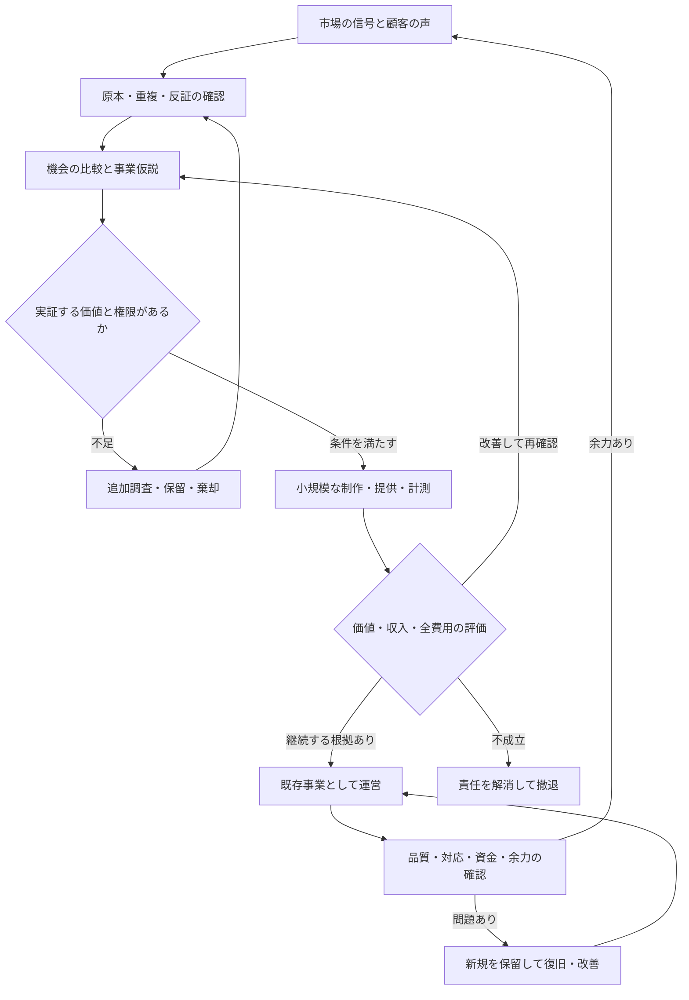

# AI会社・事業運営の統合設計書

設計改訂：2026-10-26｜設計名：市場探索型AI事業会社｜現行コード：v0.5.0

## 0. この設計の位置付け

本書は、AIが市場から事業機会を見つけ、事業を選び、開発・販売・提供・改善する仕組みの統合仕様である。旧資料の継ぎ足しを主仕様にせず、本書とSYSTEM_IMPLEMENTATION_BLUEPRINT.md、BUSINESS_AND_SYSTEM_REVIEW.md、CLAUDE_CODE_START.txtを現行の入口にする。

事業の成功はまだ実証されていない。本書の数字や業務例は、明示したものを除き設計・提案であり、顧客数・売上の実績ではない。予算、認証、口座、公開アカウント等の設定も完了したとは扱わない。

| 表記 | 意味 | 現時点の例 |
|---|---|---|
| 確認した事実 | 実際に読んだソース・公式資料・実行ログ | 42役割、現行の台帳、109テストの成功 |
| 設計決定 | 目標を達成するための今後の作り方 | 横断収集、候補評価、実証、モバイル管理 |
| 仮説 | 実市場の観察で検証する見立て | 特定テーマに需要や支払意思があること |
| 実測 | 実顧客・許可された自社データから確認する結果 | 本成果物で確認した事業の実測はない |

再構築の対象は会社の仕事・判断・情報・実行のつながり。実際に接続していない機能を完成済みとは表現しない。FRIDAY連携は対象外。

## 1. 経営上の結論

採用するのは、広く機会を探し、少数の実証へ絞り、顧客価値と全費用を確かめながら育てるAI事業会社である。

会社の収入源は、自社で運営する動画・アプリ・サービス・商品等が顧客や視聴者、広告主へ提供する価値。AI社員の会議や、この会社OSを作ったこと自体から収入が生まれるわけではない。会社OSを他社へ売る案も、将来の調査候補の一つとして扱う。

初期の成功条件は「一つの価値を届け、その利用・収入・費用・対応を追えること」。多数のAIを同時稼働させることや、多数の商品を公開することを成功条件にしない。

## 2. 目的・制約・優先順位

1. 顧客・視聴者が期待する価値を、誤認を生まずに届ける。
2. 既存の提供責任、問い合わせ、返金・解約、維持に必要な資金を守る。
3. 事業単位で収入・全費用・資金回収・本人の介入を確認する。
4. 利用できるAI・自動化によって、人の時間を増やさず再現可能にする。
5. 余力の範囲で、次の機会を探索・実証する。
6. 顧客関係、権利、運用、収支を引き継げる状態にし、将来のM&Aの選択肢を作る。

理念・顧客価値・人への影響・技術・資金・利益・社会価値を判断に含める。短期売上を理由に、誤情報、隠された条件、不必要な個人情報の収集を事業の仕組みに組み込まない。

無料・低費用を優先する。ただし、無料枠、既存契約、API、電力、保守、本人の無償労働を同一視しない。無料で成立しない部分は、費用・必要性・代替案を示して判断対象にする。

## 3. 比較した事業構造

| 案 | 良い点 | 構造的な弱点 | 判断 |
|---|---|---|---|
| A：全市場・全商品を完全自律で同時展開 | 機会の幅が大きい | 集客・権利・保守・資金の複雑さが先に増え、損失原因を追いにくい | 初期は採用しない |
| B：本人が選んだ一商品だけを自動化 | 対象が明確で検証しやすい | AIに機会探索・選定も任せたい目的を満たさない | 部分的な手法として使う |
| C：動画等、一つの業態に特化した制作会社 | 工程を標準化しやすい | 特定媒体や収益モデルへ依存し、比較前に機会を狭める | 調査で優位なら採用可能 |
| D：幅広い探索＋段階的な実証＋既存運営の保護 | ユーザーの目的と資金・品質の制約を両立 | 選定基準と実測経路を作る必要がある | 採用 |

採用案Dでも、すべてを自動判断できるわけではない。本人は方針と権限の境界を決め、AIはその範囲で選定・実行・改善する。例外と未確認の重大事項は本人へ戻す。

## 4. 全体の業務構造

日常業務はこの循環で進める。会議は循環の一工程であり、すべての社員を毎回会議へ参加させない。結論と証拠が整えば、事前の権限内で次へ進む。

## 5. オーナーとAI社長の分担

| 主体 | 決めること・すること | 自分では変えないもの |
|---|---|---|
| 本人 | 目的、資金の出所と上限、許可対象、禁止領域、重大な例外、必要な本人認証・契約 | 未確認の実績を成功扱いにしない |
| AI社長 | 優先順位、部門への仕事、候補の採用・保留案、既存と新規の配分案、報告 | 本人の支出上限・権限・契約主体を勝手に拡張しない |
| 部長 | 担当範囲の成果物と品質、課長への計画、他部門との引継ぎ | 他部門の確定事実を捏造しない |
| 課長 | 仕事を具体化し、担当の成果を検収する | 根拠なしに検収を通さない |
| 担当 | 検索、分析、制作、実装、照合などの割り当てられた実作業 | 自分の成果を自分で最終承認しない |
| AI監査役 | 反証、状態と権限の確認、異常停止、本人への説明 | 自分で本番再開や増額をしない |

本人の毎日の作業を「商品を考える」「全投稿を許可する」に固定しない。本人が先に限定的な運営方針を認めた範囲は、規則をコードで確認して自動実行する。

## 6. 会社・部署・社員の構造

既存の8部・16課・42役割を維持する。AI社長1、部長8、課長16、担当16、監査役1。肩書は仕事と権限の表示であり、42個の別モデル契約や42人の常時稼働を意味しない。

| 部署 | 2つの課 | 主成果物 | 受け取る情報 | 次に渡す相手 |
|---|---|---|---|---|
| 経営企画部 | 事業戦略課／新規事業課 | 優先順位、候補比較、実証計画、継続・撤退案 | 市場調査、全費用、運営余力 | AI社長、商品開発、財務 |
| マーケティング部 | 市場調査課／集客課 | 原本付き需要仮説、販路、訴求、流入分析 | SNS、検索、レビュー、顧客の声 | 商品開発、営業、経営企画 |
| 商品開発部 | 商品企画課／制作課 | 価値・範囲・完成条件、最小商品、改善版 | 課題・願望、代替、利用上の問題 | 営業、顧客支援、情報管理 |
| 営業部 | 営業企画課／販売運用課 | 商品説明、購入・収益化の経路、注文・収入の対応 | 提供物、対象、価格・条件 | 顧客支援、財務、経営企画 |
| 顧客支援部 | サポート課／継続支援課 | 問い合わせ解決、提供品質、継続・解約理由 | 実使用、苦情、障害、顧客回答 | 商品開発、経営企画、情報管理 |
| 財務管理部 | 予算管理課／収支管理課 | 予約・実費・収入の照合、採算、資金余力 | 課金、外部費用、契約義務、人の時間 | AI社長、監査、各責任者 |
| 人材・業務開発部 | AI社員育成課／業務改善課 | 手順・役割の改善、回帰評価、無駄の削減 | 失敗、差戻し、費用、介入履歴 | 情報管理、各部長 |
| 情報管理部 | ナレッジ管理課／システム運用課 | 証拠と履歴、Obsidian、監視、復旧 | 全社の確定記録、接続・稼働状態 | 全部門、本人 |

動画の編集・翻訳は制作課、テーマと視聴者の調査は市場調査課、配信仮説は集客課、収益化は営業・財務の職務として割り当てる。アプリ開発は同じ商品開発の職務に、コード制作・試験・配布の専門手順を読み込ませる。新業態のたびに全部署を増やさない。

## 7. AI社員一人の仕様

社員の実体は、固定ID、上司、職務、許された道具、参照できる記録、入力形式、成果物、検収者、費用・時間上限、評価と手順の版である。

各仕事に必須の項目：

- 事業ID、プロジェクトID、仕事ID、親仕事、担当・検収者。
- 目的、顧客または視聴者、前工程の証拠ID、入力の版。
- 出力形式、完成条件、使用してよい道具と対象。
- 納期、優先度、処理リース、試行上限、費用枠、止める条件。
- 実際に行った操作、成果物ID、根拠、実行していない範囲、次工程。

同じモデルの別役職を「独立した専門家の実証」とは扱わない。別役割による点検に、外部原本、決定的なコード、テスト、実顧客の観察を組み合わせる。

## 8. 市場探索の対象

問題解決に加え、楽しさ、学び、情報、創作、時間短縮を対象にする。国内と海外、法人と個人、買い切り・継続・従量・広告・協賛等を比較する。

| 情報源 | 主な問い | それだけでは分からないこと |
|---|---|---|
| YouTube | 何が見られ、どの質問・要望が出るか。テーマの供給は十分か | 他社の非公開の視聴維持率、収入、採算 |
| Instagram・TikTok | どのテーマ・表現へ公開反応があるか | 権限のない保存・購入・詳細属性等の非公開指標 |
| X・Threads・Reddit・フォーラム | 何に困り、何を望み、今どう対処しているか | 投稿者が実際に買うか、地域全体の代表性 |
| 検索・検索動向 | 何を調べ、比較し、解約・代替を探しているか | 実際の支払意思や市場全体の売上 |
| アプリ・EC・ソフトのレビュー | 満足、不満、不足、返金・解約の理由 | レビューしていない人の分布や実販売数 |
| 新製品・公式発表・研究・開発者情報 | 新しい実現手段、費用や供給の変化 | 新技術を使った商品の需要 |
| 競合・公開広告・統計 | 商品、価格、対象、販路、規模の手掛かり | 広告が黒字か、公開していない顧客・費用 |
| 自社の利用・問い合わせ・収支 | 実際に届いた価値、不満、維持・獲得費 | まだ試していない市場へそのまま移せるか |

MARKET_RESEARCH_SPEC.mdを収集の詳細契約として使う。媒体名を列挙しただけで接続済みとしない。

## 9. 探索と絞り込みの運営

一つの調査バッチを、明確な問いと上限を持つ仕事にする。対象地域・言語、媒体、検索語、期間、件数・ページ、費用、時間、終了条件を決める。

初期の運用例は「最大10候補を記録、最大3候補を深掘り、同時の有償・公開実証は最大1件」。これは作業量を制限する提案であり、成功率の根拠ではない。現行の実験枠も1件が初期値。既存の提供負荷が高ければ0件にする。

発見経路を3つ持つ。

1. 課題・願望から探す：繰り返しの質問、不満、手作業、楽しみたい目的。
2. 変化から探す：新技術、価格低下、新しい習慣、制度・供給・販路の変化。
3. 自社の実績から探す：既存顧客の隣接課題、再利用できる制作・販売能力。

話題性は候補に入れる理由。採用する理由には、具体的な価値、届く経路、実証可能性、全費用、維持する方法を要求する。すべて弱ければ採用なしを認める。

## 10. 証拠と情報品質

証拠IDごとに、原本URL・外部ID、元情報のグループ、媒体、公開・更新・取得日時、地域・言語、検索条件、確認範囲、要約、指標と期間、利用・保存条件を持つ。

検索抜粋のみ、記事本文、動画の確認区間、字幕、コメント、本人の報告を区別する。未視聴の動画を視聴済みとしない。字幕の存在だけで内容の正しさを保証しない。

| 層 | 内容 | 判断での使い方 |
|---|---|---|
| 原本で観察した事実 | 公開価格、公開コメント、利用可能な公式データ | 観察した範囲に限って使用 |
| 他者の主張 | 成果報告、売上の自己申告、顧客の感想 | 発言として保存。検証済みの収益へ変換しない |
| AIの推論・仮説 | 不足していそうな商品、原因や購入理由 | 次の検証を設計する材料 |
| 自社の実測 | 認証済みイベント、照合した費用、顧客の実使用 | 対象・期間・品質が確認できるときに判断へ使用 |

同じ発表の転載や同一運営者の反復をまとめる。複数媒体で同じ話が出ても、独立した顧客の需要とは限らない。
Google Trendsは相対的な検索関心の指標であり、そのまま顧客数や販売数にはならない。[SRC-05]

## 11. 機会カードと共同検討

候補ごとに次の項目を一枚の構造化カードへまとめる。

| 項目 | 必須内容 |
|---|---|
| 対象 | 国・言語、使用者、支払者、具体的な場面 |
| 価値 | 解決する問題または得たい体験、現在の代替、違い |
| 市場の根拠 | 原本ID、顧客の声、代替・支出、販路・利用行動、取得できない範囲 |
| なぜ今 | 需要・供給・技術・習慣等の変化。観察と推測を区別 |
| 作るもの | 最小の提供物、作らない機能、完成条件 |
| 届け方 | 主な接点、アクセス可能な根拠、公開・送信の必要権限 |
| 収入 | 誰が何に支払うか、課金単位、収益化条件、未確定事項 |
| 費用と維持 | 制作・獲得・提供・保守・本人の時間、継続義務 |
| 反証 | 買わない・見ない理由、十分な代替、失敗例、模倣・競合の反応 |
| 実証 | 最も危険な仮説、比較対象、指標、期間、必要観測、予算、撤退条件 |
| 判断 | 採用・保留・追加調査・棄却、理由、決定者、日時、次の見直し |

マーケティングは需要と到達方法、商品開発は価値と実現方法、財務は費用と回収、顧客支援は維持と期待の差を提出する。全員が自由に長文を出す会議にせず、カードの欠落と反証を埋めて決める。

## 12. 選定の順序と判定

最初に、禁止領域・権利・到達不能・上限のない費用・維持不能を確認する。満たさない条件を高い市場評価で相殺しない。

次に、需要・価値、到達可能性、制作可能性、収益構造、維持負担、独自性、再利用、理念との適合を比較する。点数を使う場合も、根拠の有無と確からしさを別列にする。欠測を低点や平均点へ黙って置換しない。

次の仕事を選ぶ問いは「どの案なら、許可された損失内で、重要な不確実性を減らせるか」。将来利益が最大とAIが予想した順に資金を配らない。

例：動画事業で広告単価が未測定でも、制作費を制限した視聴価値の実証は設計できる。広告収益や採算が未確認のまま、増産・黒字宣言をすることはできない。
現行コードでは広告モデルや変動費未確認が計画判定を止める。実装時は「情報の不足」「限定実証の許可」「拡大の可否」を分け、偽の単価で判定を通さない。

## 13. 段階ごとの通過条件

| 段階 | 出すもの | 次へ進むための条件 | 通らない場合 |
|---|---|---|---|
| G0：方針 | 目的・権限・費用・禁止領域・既存義務 | 本人の実際の設定と接続状況が分かる | 可逆な準備・調査を進め、必要設定を具体化 |
| G1：発見 | 原本のある機会カード | 観察と仮説、重複と欠落が区別できる | 取得・原本確認を追加 |
| G2：比較 | 候補比較、最重要の不確実性 | 対象・価値・経路が具体的で、反証がある | 保留・棄却・別の仮説 |
| G3：実証準備 | 実証契約、最小仕様、費用上限 | 実証対象・期間・指標・許可・上限・停止条件が揃う | 準備を直す。有償実行はしない |
| G4：最小提供 | 試作品、説明・条件、利用・計測経路 | 期待した目的が完了でき、必要な権利・試験が確認できる | 差戻し・範囲縮小 |
| G5：実市場の観察 | 利用・収入・費用・反応の記録 | 合成・テストと本番を分け、観察が追える | 実装故障と市場反応不足を分ける |
| G6：継続判断 | 結果と反証、全費用、改善・停止案 | 事前の判断条件と実績を照合できる | 延長理由と追加上限を明示、または撤退 |
| G7：運営移行 | 責任者、保守・対応、運営資金、監視 | 提供義務を守る方法と資金を確保 | 新規拡大を止める |
| G8：拡大 | 継続利用・回収・品質・余力の観察 | 再現性と維持能力に根拠がある | 改善または規模維持 |
| G9：撤退 | 告知・返金・移行・契約・費用の解消記録 | 顧客と外部への義務、未知結果が解消 | EXITINGを維持 |

G0〜G9は業務工程の設計。現行のventure状態をそのまま置き換える実装ではない。工程と既存のPROPOSED・ACTIVE・OPERATING・EXITING・CLOSED等の対応を実装仕様で管理する。

## 14. 実証契約の詳細

実証前に、目的、対象顧客・視聴者、仮説、変更する要因、最小提供物、主指標1つ、補助指標、品質・資金の停止条件、期間、最大件数・費用、必要観測、結果の判断者を固定する。

途中で目標を変更する場合は旧版を残す。結果を見てから成功基準を下げて成功と記録しない。観察不足なら「不明」とし、基準を満たしたとは扱わない。

期間が来たら自動で次の実証へ資金を移さない。未確定費用、顧客の義務、本人の承認枠を照合する。観察が遅い事業では、期間と回収の遅れを最初に記す。

クリック、無料登録、アンケート、購入、使用、継続、正味収入を別の段階にする。最初の一件は経路の実証であり、市場適合や安定利益の証明ではない。

## 15. 海外向けYouTube・メディア事業の一巡

1. 国・言語・視聴場面・テーマを調べる。日本向けの成功例を、そのまま海外の需要へ換算しない。
2. 類似コンテンツの公開反応、コメント、代替、伸びなかった例、供給の不足を確認する。
3. 視聴者が選ぶ理由とチャンネルの約束を決め、一本の企画・構成・独自情報を作る。
4. 台本の事実、引用、素材・音声・人物・音楽の利用条件、現地語の自然さを確認する。
5. 生成・収録・編集・字幕・音量・サムネイルを制作し、内容と表示の一致を検収する。
6. 対象アカウント、内容の版、公開方法、権利、必要なAI表示、費用・許可を再確認して公開する。
7. 自社アカウントで取得できる視聴・維持・再訪・流入を取得し、公開競合データと区別する。
8. 広告、協賛、アフィリエイト、商品、会員等の収入を別に管理し、発生と受領の時点を分ける。
9. 制作原価、修正、翻訳、獲得、対応、収益化までの支出、本人の確認時間から改善・継続を決める。

収益化条件を満たしていない間の広告収入を、再生数に推定単価を掛けて実績化しない。広告主は支払者、視聴者は価値を受ける側として、両方の条件を設計する。

YouTubeでは反復・大量生産と見なされる内容や、十分な独自価値のない再利用が収益化の障害になる。AIを使うことと収益化できることを同一視しない。[SRC-01]
現実らしく見える一定のAI生成・改変には開示が必要とされる。公開時点の公式条件を確認する。[SRC-02]

## 16. 問題解決アプリ・サブスク事業の一巡

1. レビューや質問から、誰がどの場面で何を完了できないかを具体化する。
2. 現在のアプリ・表計算・手作業・外注で十分か、切替の負担に見合う差があるかを確認する。
3. 一つの重要操作に絞り、入力→処理→役に立つ結果→やり直しまでを仕様にする。
4. 隔離環境で実装し、正常・失敗・長い入力・再送・権限・データ消去を必要な範囲で試験する。
5. 対象、できること、価格・更新・解約・返金、データ利用、問い合わせを分かる言葉で示す。
6. 認証・購入・支払・利用権・初回価値・再利用・問い合わせ・解約を接続する。
7. 課金通知の重複や順不同を処理し、契約の状態だけで入金を断定しない。[SRC-06][SRC-07]
8. コホートごとの利用・継続、獲得と推論・保守・対応の費用を観察する。
9. 利用されない理由を、対象・価値・説明・操作・性能・価格へ分けて改善する。

利用されないアプリを機能追加だけで救わない。Webで検証できる価値に、最初から複数ストア対応を義務付けない。ネイティブ機能・配布経路が価値に必要かを先に確かめる。

## 17. サービス・商品販売の一巡

サービス・デジタル商品では、対象と購入目的、見本、提供範囲、完成条件、納期、必要入力、修正回数、支払・返金条件を先に定める。

入力不足や例外を「何でも対応する」約束で吸収しない。標準範囲、追加対応、提供できない場合の扱いを明示する。価格より人の介入が増える場合は、範囲・方式・価格を見直す。

物理商品では、製造・調達、品質、安全性、表示、在庫、配送、返品、輸出入等の条件を追加する。AIによる企画・画像生成ができても、仕入・品質保証・物流・顧客責任まで自動で成立するわけではない。

各業態に必要な契約や専門的確認は、対象国と実際の提供内容を決めて行う。未確認なら公開・受注範囲を限定する。

## 18. 商品開発の共通契約

商品仕様には、対象、場面、提供価値、最重要操作、期待する結果、範囲外、品質の確認方法、費用上限、依存先、失敗時の説明、運営責任を持たせる。

制作の完成条件と事業の成功条件を分ける。動画ファイルの書き出し、アプリのビルド、販売ページの公開は制作の成果。視聴・利用・購入・継続・採算は市場の成果である。

品質点検は、形式・機能、事実、顧客の目的、表現・期待、権利・取扱い、提供・復旧の観点で行う。重要でない装飾の完全化を、実証の開始条件に増やし続けない。

## 19. 集客・販売・信頼形成

販路は商品と同時に設計する。見つけてもらう場所、クリック・紹介の理由、価値が理解できる説明、利用・購入への摩擦、再訪・継続の理由までをつなぐ。

初期は主経路を一つに絞り、別経路は補助として記録する。コンテンツ、検索、コミュニティ、紹介、広告等のどれを選ぶかは、対象へ適切に到達できる証拠と費用で判断する。

買わない理由を順に点検する：対象へ届いていない／約束が伝わらない／差がない／信用できない／価格・条件が合わない／操作が難しい／一度で十分／提供が不安定。

購入を増やすために顧客の誤解を放置しない。好意的な評価だけを集めて品質を偽装しない。苦情・低評価・返品は改善材料として原本と対応を残す。

## 20. 既存事業と新しい事業の両立

| 区分 | 主な仕事 | 資金と実行の扱い |
|---|---|---|
| RUN | 現在の提供、監視、照合、問い合わせ、返金・解約、契約更新 | 既存義務と保護枠を先に確保 |
| IMPROVE | 同じ事業の不満・操作・価値・原価・継続の改善 | 影響範囲・検証・戻す手段を持つ。独立枠は次の実装 |
| EXPLORE | 新市場、新商品、新しい収益モデルの実証 | 品質・資金・対応余力が確認できた分だけ |

固定の配分率を強制しない。監視と対応に専用の実行余力を残し、大きな開発や動画生成で占有しない。

重大障害、対応期限超過、観測欠落、費用不明、余力不足では新規の公開・支出を保留し、復旧と既存提供へ集中する。品質を理由に新規を抑える考え方はGoogle SREの方針例を参考にするが、同社の数値閾値をそのまま流用しない。[SRC-08]

原価や結果が不明な操作の予約を勝手に解放しない。現行コードの限定RUNは、本人の明示方針、上限の根拠、分離対象、保護枠、全社上限が揃う場合に限る。根拠は現在は本人記録であり、自動で外部検証済みとは扱わない。

## 21. 顧客満足とサポート

満足は星の平均だけで判断しない。目的を達成したか、問い合わせが期限内に解消したか、同じ問題が再発したか、使い続けるか、返金・解約の理由は何かを観察する。

問い合わせは、事業・顧客・注文または利用記録・重要度・期限・担当・根拠・回答・結果へ結ぶ。返金等の外部操作は、事前の規則と権限をコードで確認する。

同じ苦情が反復したら、回答テンプレートの改善だけで終わらせず、商品・説明・課金・操作の原因へ戻す。重大な顧客影響や、AIで解決できない判断は、本人等の実際に存在する責任者へエスカレーションする。

24時間対応や専門家対応を約束するなら、それを満たす実行体制・代替者・予算が必要。AIがいるという理由だけで約束しない。

## 22. 収益・費用・資金の見方

取引通貨、報告通貨、対象期間、税込・税抜、発生時点と受領時点を明示する。初期コードの資金制御はJPYのみ。海外への提供と多通貨台帳の対応を同義にしない。

次を別に表示する：注文、請求、支払、正味受領、銀行への入金、返金、未提供分、継続契約、会計上の売上。観察した現金の差を、そのまま税務上の利益と呼ばない。

期間の現金貢献＝当該期間の実受領－返金－外部へ支払った制作・獲得・提供・保守・共通費等。
経済性の確認＝上記の貢献に、本人や協力者の時間等の機会費用を加味する。投資回収では初期開発・失敗案の費用も残す。

費用は、事業固有、獲得、提供、維持、共通基盤、失敗した探索、人の時間へ分類する。複数事業で使う費用の配賦根拠を保存し、配賦前の全社総額と一致させる。

CACは、定めた期間・顧客群の獲得費を新規の支払顧客等の明示した母数で割る。広告だけ、成功した受注だけの費用で有利に見せない。母数0は0円ではなく算定不可。

短い観察から永久のLTVを計算しない。現時点で観察できた期間内の回収、継続の不確実性、費用の変動を示す。

## 23. 数字で見る構造上の落とし穴

次の2例は計算確認用の架空データ。市場予測、価格提案、実績、決済事業者の実手数料ではない。期間と費用の対応が取れている前提。

| 月次例 | 小さなサブスク | メディア |
|---|---:|---:|
| 総受領 | 60,000円 | 15,000円 |
| 返金 | 3,000円 | 0円 |
| 外部運営・獲得等の費用 | 38,400円 | 24,800円 |
| 初期費用を除く現金貢献 | 18,600円 | -9,800円 |
| 本人の時間の仮定評価 | 16,000円 | 12,000円 |
| 初期費用を除く経済的な残額 | 2,600円 | -21,800円 |
| 当月に初期費用40,000円も払う場合の現金貢献 | -21,400円 | この例では追加設定なし |

サブスクの仮定：月3,000円×20人、1人分返金。費用は決済2,400円、基盤8,000円、API12,000円、広告12,000円、獲得用制作4,000円。本人8時間を時給2,000円相当で評価。新規支払5人を獲得し、そのうち獲得に本人3時間を使った仮定なら、CACは(12,000＋4,000＋6,000)÷5＝4,400円。

メディアの仮定：広告等12,000円、紹介等3,000円の当期受領、制作15,000円、翻訳4,800円、ツール3,000円、配信2,000円。本人6時間を同じ仮定単価で評価。再生があっても、この費用構造では残額がマイナスになる。

月の現金がプラスでも、本人の時間と初期費用を回収できるとは限らない。売上を増やす前に、単位原価と運営負担が増える構造かを確認する。計算値はreview/economics.jsonと付属の確認スクリプトで再計算する。

## 24. KPIの構造と意思決定

全社の常時表示は原則3項目に絞る。

| 主KPI | 定義・正本 | 用途と限界 |
|---|---|---|
| 照合した現金貢献 | 期間内受領－返金－期間内支出。原本と配賦前総額へ戻れる | 資金の持続性。発生利益・未払義務と別表示 |
| 提供義務がある事業の健全性 | 対象事業数、確認済み正常・異常・不明の内訳と鮮度 | 新規を進める余力。不明を正常へ含めない |
| 本人の介入時間 | 期間内の作業・承認・復旧等の実記録。未記録を明示 | 自律性と負荷。時間単価の仮定と実費を区別 |

安全上の主な制約は、未許可の外部実行ゼロ、提供・資金の重大な未解消事項を残した新規拡大なし。これらは市場の成功率ではなく、守るべき方針。

事業別の主指標と診断指標は次のとおり。すべてを同じ単位に足し合わせない。

| 事業 | 主な成果指標 | 診断に使う指標 | 主な注意点 |
|---|---|---|---|
| アプリ | 重要操作を完了した実利用者、定めた周期の再利用 | 初回価値までの時間、失敗率、問い合わせ | 無料登録を価値実現にしない |
| サブスク | 更新対象群の支払継続と期間内回収 | 初回利用、解約理由、顧客別原価 | 観察期間を迎えていない人を不継続にしない |
| 動画 | 視聴者が選んで見続け・再訪した根拠、期間収益と原価 | 許可された自社分析の流入・維持等 | 総再生と人の数、競合の公開値と自社分析を区別 |
| 商品・サービス | 購入目的の達成、正味受領と対応後の残額 | 納期、返品・修正・再購入 | 納品を利用成功へ置き換えない |

指標辞書には、名前、意味、分子・分母、期間、対象、除外、粒度、正本、担当、更新頻度、遅延、欠測、訂正、判断先を必須にする。具体的な定義は実装仕様に記載。

目標値は実測前に業界の一般値を貼らない。仮説から逆算した上限、実証で必要な観測、契約上の約束、資金の制約を基準に仮置きし、根拠と版を残す。

## 25. 自律化と承認を両立する権限

| 区分 | 例 | 条件 |
|---|---|---|
| 内部の可逆作業 | 調査、比較、台本、試作、テスト | 利用可能な入力・道具・費用・保管条件内 |
| 事前方針内の外部実行 | 指定アカウントへの承認範囲内の公開、上限内の定型対応 | 対象・内容条件・金額・回数・期間・停止条件がサーバーで検査できる |
| 個別の重大判断 | 増額、新契約、新規の送信先、権利が不明な公開、重要な利用条件変更 | 本人に具体的な対象・差分・費用・影響を示す |
| 本人固有の操作 | 本人確認、口座・契約、ログイン等 | 本人が行う。秘密を会話へ貼る運用にしない |

承認は内容への賛成、許可は操作の権限、内部検収は成果の品質確認であり、同じボタンにまとめない。

許可には、主体、事業、操作、外部対象、内容の版または検査可能な範囲、費用・件数、期間、失効条件を持たせる。内容や対象が変わったら古い個別承認で実行しない。連続運営の許可は毎回の条件照合を必要にする。

## 26. スマホの会社管理画面

画面はスマホ中心にする。数字を一覧にするだけでなく、異常から根拠・責任者・対応へ進める構成にする。

| 画面 | 見るもの | できること |
|---|---|---|
| 全社 | 収入・支出・予約・義務・健全性・介入時間、更新日時 | 優先事項の指示、全社の新規実行停止 |
| 事業 | 価値、顧客・視聴者、収益モデル、段階、利用・費用、次の判断 | 継続・改善・撤退の判断、根拠を見る |
| 機会 | 国内外の候補、出典、反証、取得の欠落、実証案 | AIの選定理由を確認、制約や優先事項を伝える |
| 仕事・社員 | 担当、状態、進捗、成果物、待ち理由、費用 | 追加指示、優先度、再作業の依頼 |
| 判断待ち | 承認・許可・重大例外、対象版、費用、影響、期限 | 承認、差戻し、許可・取消。通信再送でも一回だけ反映 |
| 顧客・品質 | 障害、問い合わせ、期限、苦情、返金・継続 | 根拠を確認して担当へ指示 |
| 資金 | 使用済み、予約、不明、保護枠、将来支払、口座の確認状態 | 本人権限で方針設定・枠変更 |
| 知識・接続 | Obsidianへの出力、根拠、更新・失効、媒体やworkerの状態 | 履歴参照、接続手順、復旧の指示 |

未接続の値は「未接続」、欠測は「不明」、合成例は「デモ」と表示する。通知は判断の入口。届いたこと・既読を承認にしない。

## 27. 会話・ノウハウ・Obsidian

保存対象を4つに分ける。

1. 業務正本：仕事、許可、外部操作、収入・費用、顧客対応、状態の履歴。
2. 許可された原本：公開情報・顧客資料・動画等。利用・保存条件に従い、保存できなければ参照と要約。
3. 分析用の集計：期間・顧客群・媒体別の指標。正本へ戻れる定義と作成履歴。
4. 再利用する知識：手順、反証、成功・失敗の条件、原本参照、適用範囲、失効日。

会話が増えることをノウハウの価値と同一視しない。業務に結び付いた必要な履歴を残し、根拠のない仮説を「検証済みの教訓」へ昇格させない。検索・RAGとモデルの追加学習を分ける。初期は追加学習を必須にしない。

Obsidianは人が読める知識と履歴の出力先。業務・資金・権限の正本をノートの編集に依存させない。Markdownファイルの保存と機器間同期、バックアップは別の運用として設計する。[SRC-09]

顧客別の機密を全社共通知識へ混ぜない。顧客原文から再利用可能な一般化を作る場合も、利用目的・権利・削除との関係を確認する。

## 28. 運用周期と会議

以下はシステム内で実装する運用の仕様であり、このチャットで定期タスクを登録した意味ではない。

| タイミング | 動作 | 本人へ出すもの |
|---|---|---|
| 常時のイベント | 支払・利用・監視・問い合わせ・費用を保存し、必要な状態を更新 | 重大な例外だけ通知 |
| 日次の区切り | 資金・義務・未確定・期限・品質を照合 | 成果、異常、判断待ち、次の作業 |
| 調査バッチ終了 | 原本・欠落・候補・反証をまとめる | 選定・保留理由と次の限定実証 |
| 実証終了 | 事前条件と結果、全費用、介入を評価 | 継続・改善・停止と必要な判断 |
| 週次 | 既存運営と新規の配分、仮説の学習、共通費を確認 | 一枚の経営報告と根拠へのリンク |
| 期限前 | 認証・権限・保守枠・契約更新・保存期限を確認 | 期限、影響、準備した対応 |

会議を起動する条件は、重大な前提変更、部門間の未解決な反証、資金・品質の異常、投資・撤退の判断。定型の引継ぎは構造化した成果物で進める。

## 29. 例外と撤退

| 状況 | 最初の処理 | 次に判断すること |
|---|---|---|
| 媒体が取得できない | 取得失敗・範囲を保存 | 他の利用可能な根拠で進めるか、不明として保留 |
| 利用・購入が少ない | 計測と到達を確認 | 価値不足か、流入不足か、観察不足か |
| 収入があるが残額が低い | 本人時間・保守・獲得を含む原価を照合 | 範囲・価格・運用・継続を見直す |
| 外部操作の結果が不明 | 同じ操作IDで照会し、予約を保持 | 確認可能な範囲で復旧。別IDで再送しない |
| 既存品質の悪化 | 新規を保留し、影響と提供義務を確認 | 必要な保守・対応の継続と資金 |
| 規約・権利・専門判断が不明 | 対象の公開や受注を保留 | 対象を狭める、専門確認、撤退 |
| 本人が応答できない | 許可期限と既存の規則に従う | 無期限の増額・新契約で救済しない |

撤退しても、返金、利用データの取扱い、契約終了、告知、外部費用の照合は残る。利益の出ない事業を無限に続けず、責任を解消する費用を含めて判断する。

## 30. 独自性とM&Aへ残す資産

AIモデルへの接続や役職名だけでは模倣を防ぎにくい。積み上げる対象は、顧客が選ぶ理由、独自のコンテンツ・手順、再現できる集客、利用を許された観察、保守と対応の標準化、引き継げる権利・契約である。

事業ごとに、顧客・視聴者の関係、知的財産・素材、ドメイン・アカウント、外部契約、ソース、収支、運営手順、重大事故、データの権利を棚卸しする。アカウントや契約が移転可能とは前提にしない。

買収したくなるかは、利益の持続性、顧客価値、成長余地、依存と引継ぎ、買い手の目的に依存する。現在の設計とローカルテストから企業価値や売却価格を出さない。

## 31. 実装・運用へ進む順序

| 段階 | 実施内容 | 完了証拠 |
|---|---|---|
| P0 | 現行コード・データ・役割・試験を確認し、設計と実装の差を固定 | ベースラインログ、保存・復元、接続状態 |
| P1 | 本人認証、会社管理の読み取り、主体固定と許可確認 | 未認証・越権・再送・失効の試験 |
| P2 | 利用できる複数種類の情報源から一候補の根拠を収集 | 取得履歴、原本、重複、反証、計画IDへの接続 |
| P3 | AI部門が比較して一件の実証契約を作る | 採用・棄却理由、費用上限、停止条件 |
| P4 | 選んだモデルの最小提供と利用・収入・費用を接続 | 一連の識別子とテスト環境の結果 |
| P5 | 実際に与えられた対象・権限・予算内で実証 | 実顧客・視聴者の結果、費用、欠測・反証 |
| P6 | 運営保護、監視・対応、復旧、継続・撤退を検証 | 既存と実証の並行シナリオ、責任解消の証拠 |

日数は、接続・アカウント・予算・選んだ商品の難しさが未確定のため確約しない。今日の着手はP0、最初の開発区切りはP1〜P2。外部の設定待ちでも、可逆な実装・試験・候補調査を進める。

## 32. 今回の納品と未完の範囲

今回の成果は統合した詳細設計、実装仕様、受入条件、役割指示の整合、現行コードの検証、反証評価、Claude Codeへの引継ぎである。

市場の候補を本当に選定した、各SNSへ自動接続した、スマホの本番画面を公開した、顧客の購入・視聴・利益を実証した、という成果ではない。次の実装は、これらの差を一つの事業の流れに沿って埋める。

本人が今決める枠は、利用できる資金・アカウント・権限・禁止領域。商品と市場の候補選定はAI部門が担う。初期方針は現在も支出無効・0円であり、本書で変更しない。

## 33. 一次情報の参照

確認日：2026-10-26。以下は取得・収益化・運用の設計根拠。特定事業の需要や収益を証明する調査ではない。詳細な確認範囲はBUSINESS_AND_SYSTEM_REVIEW.mdの出典表を参照。

- [SRC-01：YouTube channel monetization policies](https://support.google.com/youtube/answer/1311392?hl=en)
- [SRC-02：YouTube GenAI disclosure](https://support.google.com/youtube/answer/14328491?hl=en)
- [SRC-03：YouTube Search.list](https://developers.google.com/youtube/data/reference/rest/v3/search/list)
- [SRC-04：Instagram Platform overview](https://developers.facebook.com/documentation/instagram-platform/overview)
- [SRC-05：Google Trends FAQ](https://support.google.com/trends/answer/4365533?hl=en)
- [SRC-06：Stripe Webhooks](https://docs.stripe.com/webhooks)
- [SRC-07：Stripe subscriptions](https://docs.stripe.com/billing/subscriptions/overview)
- [SRC-08：Google SRE error budget policy example](https://sre.google/workbook/error-budget-policy/)
- [SRC-09：Obsidian note syncing](https://obsidian.md/help/sync-notes)
- [SRC-10：eve documentation](https://eve.dev/docs)。実装の正本は同梱版node_modules/eve/docs。
