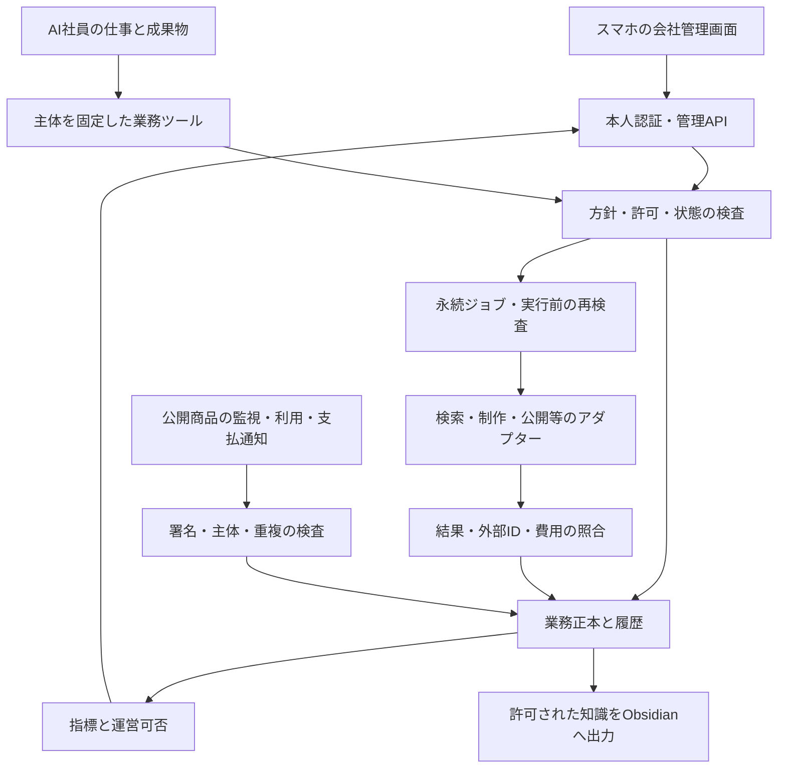

# AI会社OS：実装・データ・操作・検証の詳細仕様

2026-10-26｜対象：既存v0.5.0からの継続実装

本書は実装契約であり、ここに記す新しいテーブル・API・画面が実装済みであることを示さない。現行コードの実績と新しい受入条件は別に管理する。

## 1. アーキテクチャの決定

既存のNode.js・TypeScript・eve・SQLite・Markdown出力を再利用する。依存の全面更新や別フレームワークへの移行を最初の仕事にしない。

初期は、一つの会社管理バックエンドに、業務状態・権限・資金・外部実行の入口を集約する。AIからDB直接操作や本番の任意シェルへ到達できる構成にしない。公開商品と会社管理の認証・ルート・権限を分ける。

モデルは案を作り、登録された道具を呼ぶ。認証、金額、許可、重複、状態、締切の真偽は決定的なコードで判定する。

## 2. ホスト構成と低費用での段階導入

| 段階 | 構成 | 適用範囲 | 移行が必要になる条件 |
|---|---|---|---|
| ローカル準備 | iMac等の単一worker・SQLite・私有管理経路 | 調査、試作、模擬・内部運用 | 実顧客へ常時提供、公開Webhook、停止中も必要な処理が生じる |
| 最初の実提供 | 常時稼働する単一の運営バックエンド＋公開商品。重い制作は隔離workerも利用可能 | 一つの事業の購入・利用・収支・対応 | 同時書込み・可用性・バックアップ・処理容量の要件が単一ホストを超える |
| 複数事業 | 中央の管理DB、永続キュー、用途別worker、商品ごとの分離 | 継続提供と複数の限定実証 | 実測負荷と障害の影響範囲を見て増強 |

常時ホストや管理DBの料金を未確認のまま無料と表示しない。構成選択の基準は、提供義務、実行頻度、障害影響、回復、利用可能な予算。最初から大規模分散構成を要求しない。

単一ホストを複数のクラウド実行環境から同じSQLiteファイルの同期で共有しない。中央DBへ移す場合は、既存ID、取引の一意性、順序と履歴、金額の照合、段階的な切替と復帰を検証する。

## 3. 現行モジュールの再利用と不足

| 既存箇所 | 現在の機能 | 継続実装の方針 |
|---|---|---|
| src/company.mjs | 社員、仕事、検収、証拠、イベント、模擬費用、出力 | 固定主体と業務IDを再利用。模擬費用を実費に変換しない |
| src/ventures.mjs | 事業・投資・予約・未知結果・実費、運営保護、健康観測 | 支出と運営可否の既存入口へアダプターを接続。並列の別財布を作らない |
| src/commercial.mjs | JPYの価格付き計画、出典の自己申告、計画判定 | 収益モデル別の表現、根拠ID、実証と拡大判定を追加 |
| src/revenue.mjs | ローカルの受注、支払・返金、提供・使用、費用と履歴 | 本番原本を接続し、テストと本番・契約と支払を区別 |
| agent/**/tools | 固定社員IDによる社内道具 | 取得・制作・照合を狭い道具として追加。ownerの道具を渡さない |
| agent/**/instructions.md | 実際のAI社員の指示 | 統合設計を担当職務へ反映し、文書だけの更新で終わらせない |
| docs/employees、examples/obsidian-vault | 人が読む役割・知識の見本 | runtimeの役割と対応を保つ。実績がない表示は残す |

eveは現在の同梱文書を実装の正本にする。バージョンが違うネット上の例からAPIを推測して記述しない。previewの依存に起因する変更も回帰試験と戻す手順を持たせる。

## 4. 状態は三つの軸で分ける

1. 事業の状態：現行のPROPOSED、ACTIVE、OPERATING、STOPPED、EXITING、CLOSED等。
2. 業務の工程：G0〜G9。どこまで準備・観察・判断したか。
3. 接続・証拠の状態：ローカル、合成、外部テスト、本番接続、本番の実測、照合の有無。

ACTIVEを実顧客のいる状態、OPERATINGを黒字の状態と解釈しない。データが入ったこと、計画が完全なこと、操作できること、外部実績があることも分ける。

## 5. 主要エンティティと正本

以下は段階的に追加する論理モデル。実装のためにすべての空テーブルを先に作ることは求めない。

| エンティティ | 主キー・参照 | 内容 | 既存との接続 |
|---|---|---|---|
| 方針・許可 | policy_id、grant_id、version | 操作・対象・期間・金額・失効 | venture_policies、operating_grants等を拡張 |
| 事業・プロジェクト | venture_id、project_id | 対象、価値、段階、責任者 | ventures、projectsを維持 |
| 調査バッチ | research_run_id | 問い、地域言語、媒体・検索条件、上限、終了 | project_idと担当仕事へ結ぶ |
| 取得試行 | fetch_attempt_id、research_run_id | 開始終了、経路、検索語、範囲、結果、費用 | 外部operation_idへ結ぶ |
| 原本・観測 | source_id、observation_id、origin_group_id | URL/外部ID、内容・時刻・期間、確認範囲 | 既存evidenceへ参照を追加 |
| 機会カード | opportunity_id、revision | 対象、価値、代替、販路、収益、反証 | projectと商業計画へ結ぶ |
| 判断記録 | decision_id、opportunity_revision | 比較、採用・棄却・保留、根拠、次の問い | eventsと成果物へ結ぶ |
| 実証契約 | experiment_id、revision | 仮説、主指標、上限、期間、停止条件 | venture・commercial planへ結ぶ |
| 商品・版 | product_id、release_id、artifact_hash | 提供物、完成条件、品質、権利、依存 | artifactsと制作jobへ結ぶ |
| 外部操作 | operation_id、provider_object_id | 対象、許可、hash、予約、結果、照合 | venture_operationsを正本にする |
| 使用者・支払者 | customer_ref、audience_scope、payer_ref | 役割、許可された最小の属性 | 受注・利用・収入へ参照 |
| 注文・契約・請求 | order_id、subscription_id、invoice_id | 条件・期間・版・状態 | revenueの既存記録に原本を接続 |
| 支払・収入・返金 | provider_event_id、transaction_id | 金額、通貨、発生・受領・返金、期間帰属 | 重複を排除し既存収支へ反映 |
| 利用・視聴観測 | usage_event_id、metric_observation_id | 重要操作・期間・母数・取得方法 | 実証とKPIへ集計 |
| 問い合わせ・障害 | case_id、incident_id | 期限、重要度、原因、結果、影響 | 健康観測と運営可否へ反映 |
| 知識と出力 | knowledge_id、revision、export_id | 教訓、適用、根拠、失効、利用範囲 | Obsidianの出力へ結ぶ |

外部の本番ID、内部ID、表示名を混同しない。外部IDはprovider、アカウント、環境と組み合わせて一意にする。訂正は旧記録を残す新しい版または補正イベントで表す。

## 6. 共通フィールドとデータの品質

主な業務記録に、company_id、venture_id、project_id、actor_type、actor_id、schema_version、created_at、occurred_at、observed_at、source_ref、environment、verification_status、supersedes_idを必要な範囲で持たせる。

時刻はUTCのISO形式で保存し、表示では本人のタイムゾーンを使う。公開日不明を取得日と同じにしない。受信が遅れた観測で新しい異常を上書きしない。

verification_statusの例：AI_HYPOTHESIS、ATTRIBUTED_CLAIM、PUBLIC_OBSERVED、OPERATOR_RECORDED、PROVIDER_TEST、PROVIDER_LIVE、RECONCILED。ランクが上がるという単純な序列ではなく、どの範囲で確かめたかを表す。

nullは欠測・未接続・不明等の理由コードと組にする。ゼロは測れたゼロだけ。金額は安全な整数の最小通貨単位、通貨と課金単位を持つ。初期JPY以外を黙って円へ変換しない。

## 7. 情報源アダプターの契約

接続情報の型：source_kind、adapter_id、adapter_version、account_scope、capabilities、connection_status、limits、cost_basis、retention_policy、last_success_at。

capabilitiesは、検索、投稿本文、動画メタデータ、動画内容、コメント、公開指標、自社の認証済み分析等を個別に表す。「Instagram対応」の一つのフラグで全取得を意味させない。

検索要求の型：research_run_id、query、source_kind、locale、region、published_range、sort、max_items、max_pages、budget_ref、requested_capabilities。

検索結果の型：items、attempted_query、coverage、next_cursor、truncated、status、reason、cost_observation、observed_at。結果の各項目は原本・取得範囲の参照を持つ。

| 状態 | 意味 | 後工程 |
|---|---|---|
| AVAILABLE | 指定した能力と範囲が使える | その範囲で取得 |
| PARTIAL | 検索抜粋等の一部のみ | 欠落を保持し、原本確認または仮説扱い |
| AUTH_REQUIRED | 許可された認証がない | 設定手順を準備し、他の利用可能な情報で進める |
| RATE_LIMITED | 現在は上限に達した | 上限と再試行条件を保存。盲目的な再試行をしない |
| FAILED | 取得失敗 | 原因・試行・費用の不明を記録 |
| NOT_CONNECTED | 未接続 | 取得済みやゼロ件と表示しない |
| UNSUPPORTED | その経路では対象の情報を取得できない | 別の許可された経路または欠測 |

YouTubeには検索・コメント等の公式経路があるが、検索条件や結果集合に制約がある。地域指定を視聴者の国の実測、検索結果数を正確な市場規模としない。[SRC-03]
Instagramの公式能力・権限を接続時に確認する。任意の一般アカウントや全コメントの取得を設計上の前提にしない。[SRC-04]

## 8. 重複・偏り・更新の処理

原本IDまたは正規化URLで同一候補をまとめ、内容の類似・元発表・運営主体からorigin_group_idの候補を作る。AIが同一と推測した場合は推測であることと理由を残す。

同一原本を再取得した場合は観測日時ごとの版。別の顧客や別の裏付けへ数え直さない。転載でも独自の顧客発言がある場合は、その発言部分の根拠を分ける。

生データの件数、原本の数、独立した根拠の推定数、媒体・地域の分布を別に表示する。代表性がないサンプルの割合を、そのまま市場全体の割合へ換算しない。

元投稿の削除・条件変更・価格更新・指標の訂正は、利用中の判断・教訓へ影響確認を発行する。過去に判断した根拠の参照と、現時点で使える情報を区別する。

## 9. 候補比較と判断サービス

入力：同じ判断時点の機会カード、証拠の取得状態、本人方針、既存運営の可否、利用可能な費用・期間。

出力：候補ごとの阻害条件、根拠と欠測、比較の理由、次に減らす不確実性、採用・保留・棄却、決定した版。

AIは意味の解釈と比較案を作る。禁止対象、上限、期限、参照ID、必要項目の真偽はコードで検査する。比較の点数から支払や公開の許可を発行しない。

スコアを使う場合の例：0＝反証あり、1＝弱い間接根拠、2＝複数の整合する観察、3＝限定した実行・実測の根拠。未調査はnull。分野ごとに根拠の種類も出し、点数の平均が高いだけで採用しない。

## 10. 収益モデルと計画判定の拡張

現行CommercialPlannerのprice_yen・variable_cost_yenだけでは、無料視聴者と広告主、協賛、複数収入の時間差を表せない。既存の計画ID・履歴を保ち、次の構造へ段階的に拡張する。

共通：audience_or_user、payer、value_proposition、distribution、delivery、revenue_streams、cost_structure、experiment、evidence_refs、counterevidence。

revenue_streamsの各項目：type、payer_type、currency、unit_basis、rateまたはnull、rate_basis、eligibility、estimated_or_observed、attribution_period、recognition_status、cash_received_status。

| type | 収入単位の例 | 必須の区別 |
|---|---|---|
| one_time | 一注文・一商品 | 注文、支払、返金、提供 |
| subscription | 一契約・一期間 | 月額換算、更新、支払、解約、利用権 |
| usage | 一処理・一定使用量 | 計測単位、上限、請求と受領 |
| advertising | 条件に合う視聴等と実際の収益 | 対象・期間・収益化資格、推計と確定・受領 |
| sponsorship | 一契約・一提供範囲 | 契約、掲載義務、検収、請求・受領 |
| affiliate | 成果条件を満たす紹介 | クリック、購入、取消、承認、支払 |

未確定の広告単価はnull。制作費を制限できる実証と、採算・拡大判断を分ける。

新しい判定の出力は以下の四つを混ぜない：

- plan_completeness：計画として必要な内容と未確認を記述できているか。
- experiment_readiness：必要な条件・観測・上限が揃い、限定実証を準備できるか。権限の発行そのものではない。
- operating_readiness：既存責任・資金・監視・対応が維持できるか。
- growth_evidence：価値・継続・回収・余力の実測が拡大を支持するか。

旧assessの広告モデル等の阻害を、設定値を偽って外さない。旧計画は旧版の意味で読めるようにし、新しい版を作って比較・移行する。

## 11. 外部実行のプロトコル

1. AIが、目的・対象・入力版・操作・最大費用の実行要求を作る。
2. サーバーが主体、実際の許可、対象、状態、期限、hash、予算を確認する。
3. 同じ冪等キーとpayloadの関係を確認し、費用を予約して操作IDを確定する。
4. 実行直前に現在の許可・停止・対象を再検査する。
5. providerへ操作IDまたは公式の冪等キーを対応させて一回送る。
6. 結果・外部ID・確認した費用を保存し、実費を照合する。
7. 結果が不明ならUNKNOWNのまま照会し、予約を残す。新IDで同じ公開・課金等を盲目的に実行しない。

事前承認を取得していても、二重実行は別に防ぐ。providerに冪等性や照会能力がない場合は、その制約をリスクとして実行前に扱う。

## 12. 資金と運営保護

現行のgross_spend_limit_yenは累計の支出露出の制約。銀行の残高や今後払える金額そのものではない。実口座・未払・返金責任等の確認を別に接続する。

露出の集計は、確定支出、未解消の予約・実行中・UNKNOWNの上限、未使用の運営保護枠を含む。保護枠内の予約や支出は二重計上しない。UNKNOWN上限の期限切れを資金解放の理由にしない。

IMPROVEの独立した資金・優先制御を追加する場合も、現行と同じ全社正本の中へ統合する。新しい台帳で全社上限を回避しない。

前払い、継続契約、返金見込み、外部更新、未照合費用を将来義務として確認する。既存顧客の提供資金を新しい実験の無料資金とみなさない。

予約と実際の請求に差が出たら実費を記録し、以後の支出を停止または限定する。推定料金表・為替・課金量の版と、最終請求の照合結果を残す。

## 13. 永続ジョブ・優先度・復旧

jobはid、business_id、task_id、lane、priority、state、dedupe_key、payload_hash、not_before、deadline、lease_until、attempts、max_attempts、cost_reservation、last_progress_at、result_refを持つ。

推奨の優先順は、顧客影響のある復旧・課金照合・期限付きの対応、通常提供、改善、限定実証、広い探索。重い生成に別枠を設け、保守・支払照合を飢餓状態にしない。

workerのheartbeatと仕事の進捗は別に記録する。heartbeatがあるだけで納品が進んでいるとはしない。再起動はリースと外部結果を照合して復旧する。

現行には再試行や予約に関するローカル制御があるが、高並行の外部実行や優先キューの完成を意味しない。並列化は上限・照合・冪等性の試験後に行う。

## 14. 認証・権限・秘密

管理画面のセッションからownerをサーバーで確定する。クライアントのemployee_id・ownerフラグを信用しない。AIの社員IDはツール側で固定する。

本人用CLIは信頼できるローカル操作の入口であり、そのままHTTPやLLMの道具へ公開しない。支出方針、運営枠、不明費用上限、責任解消、本番再開はownerの機能として分ける。

読み取りも役割・事業・顧客の範囲を検査する。全文ログ・秘密・支払情報を全社員のプロンプトへ渡さない。秘密は実行サーバーの保管先に置き、必要な操作を狭いアダプター経由で使う。

管理の変更はPOST等の適切な方法、セッション、CSRF・Origin等の対策、対象版、期限、冪等キーを確認する。公開Webhookはブラウザーの管理セッションに依存させず、providerの署名等で別に検証する。

生成コードは本番鍵・顧客原本から隔離し、依存・ネットワーク・資源を制限する。外部記事、コメント、README、生成物の命令を会社の権限にしない。

## 15. スマホAPIの設計

以下のパスは新規実装の提案。現行CLIのURL版として公開しない。

| API群 | 読み取り例 | 変更例・検査 |
|---|---|---|
| owner overview | GET /v1/owner/overview | 全社の確認日時・不明・対象期間を返す |
| 事業 | GET /v1/owner/ventures/:id | 指示・継続判断・撤退要求。対象版と理由 |
| 機会・証拠 | GET /v1/owner/opportunities、/:id/evidence | 追加制約・差戻し。根拠を上書きしない |
| 仕事 | GET /v1/owner/tasks/:id | POST /:id/directives。自然文を無制限な許可に変換しない |
| 判断待ち | GET /v1/owner/decisions | POST /:id/approve、/reject。承認種別と内容hash |
| 許可 | GET /v1/owner/grants | POST /grants、/:id/revoke。本人、対象、上限、期間 |
| 停止 | GET /v1/owner/control | POST /pause、/resume。受付とworker確認を区別 |
| 接続・観測 | GET /v1/owner/connections、/health | 必要設定と診断コードのみ。秘密値を返さない |
| 知識 | GET /v1/owner/knowledge/:id | 出力・訂正要求。資金・許可を直接変更しない |
| 顧客本番 | 商品ごとの認証・利用API | ownerの管理APIとアクセス範囲を分離 |
| provider通知 | /hooks/:provider | 署名、環境・アカウント、重複、順不同を処理 |

変更要求はrequest_id、entity_version、idempotency_key、reasonと対象内容を持つ。応答はaccepted、applied、rejected、pending_reconciliationを区別し、押した直後に外部完了と表示しない。

## 16. スマホ画面の状態と承認カード

承認カードの必須表示は、判断の種類、対象事業、AIの提案、根拠、反証・不明、対象の版、実行先、費用・回数・期間、顧客への影響、戻す方法、失効条件。

承認済み、許可済み、実行待ち、実行中、結果不明、完了、失効、取消、失敗を表示する。オフライン時は古い表示であることを示し、権限変更や外部操作の完了を楽観的に確定しない。

「全社停止」は新しい操作を止める指示であり、外部で開始した生成・配信をすべて取り消せる保証ではない。受付時刻、worker確認、止められない操作、照合継続を表示する。

既存顧客への静的な提供や支払通知の記録、確定した費用の照合は、停止の意味を定義して維持する。新しい支出を伴う保守は現行の資金条件を迂回しない。

## 17. 支払・視聴・利用の取り込み

providerイベントは、受信時に署名・アカウント・テスト/本番を検証し、外部イベントIDを一意に保存してから非同期処理する。重複・遅延・順不同でも二重付与や二重返金が起きないようにする。[SRC-06]

支払・契約の状態と利用権の有効期間を対応させる。支払成功通知、売上の確定、銀行の入金を同じ事実にしない。自社の返金・猶予方針を明示し、AIの自由判断で利用権を変更しない。[SRC-07]

動画の集計はplatform、channel、content_id、metric、period、dimensions、value、unit、retrieved_at、access_scope、report_revisionを持つ。推定収益、確定収益、受領は別の記録。

アプリの使用イベントは、テスト・管理者・自動監視・ボットを識別できる範囲で分ける。監視の成功件数を顧客の使用成功数へ混ぜない。

## 18. 指標辞書の具体形

| ID | 定義と期間 | 分子・分母／集計 | 正本・欠測 | 判断 |
|---|---|---|---|---|
| CASH_CONTRIBUTION | 選択した期間の現金貢献 | 受領－返金－支出。内部移動と資金注入を収入へ含めない | 照合した支払・支出。未照合を別表示 | 資金余力・配分 |
| SERVICE_HEALTH | その時点で義務のある事業の状態 | 正常・異常・不明と各件数。割合を出すときは対象総数を併記 | 監視・対応・費用・期限。古い観測は不明 | 新規を進めるか |
| OWNER_TIME | 期間内の介入時間 | 作業・確認・承認・復旧を分類して合計 | 実記録。未記録時間は不明 | 自律性・範囲・原価 |
| FIRST_VALUE_7D | 登録後7日までに重要操作を完了した対象群 | 完了した人／7日間の観察機会がある対象者 | 使用イベント。期間未到達は除外して件数表示 | オンボーディング |
| PAID_RENEWAL | 指定期間に更新を迎えた対象群の更新支払 | 方針で定めた猶予期間までに支払確認した契約／観察期間を満たした更新対象契約 | 契約・請求・支払・返金の対応。猶予中を別表示 | 継続価値と回収 |
| CAC_COHORT | 定義した獲得活動と新規顧客群 | 広告＋制作＋販売対応等の配賦費用／重複排除した対象の新規支払者 | 獲得費・時間・取引。母数0や帰属不明は算定不可 | 経路・回収 |
| MEDIA_VALUE | 一媒体・一テーマ・同じ観測窓の視聴価値 | 利用可能な自社分析の維持・再訪等。指標ごとに対象と母数を示す | 許可された分析。公開競合の推定は混ぜない | テーマ・制作改善 |
| SUPPORT_OVERDUE | 期限が過ぎ未解決の対応 | 重要度別の未解決数、対象件数、最古の期限 | 問い合わせ。自動返信だけで解決にしない | 復旧・新規保留 |
| UNIT_COST | 明示した単位の制作・提供・維持費 | 同じ範囲の費用／処理・提供等の単位数 | 費用と利用の対応。失敗・修正も含める | 価格・方式・範囲 |

7日等の期間は定義例。選んだ商品の使用周期に合わせて実装前に決める。目標値は未設定であり、この表は合格率の約束ではない。
FIRST_VALUEを無料登録数、PAID_RENEWALを契約active件数、CASH_CONTRIBUTIONを会計利益へ表示し替えない。

## 19. 健康観測と運営判断

サービスごとに、重要操作、測定期間、SLO、重大障害、対応期限、費用照合、余力、観測の有効期限を定義する。

既存recordServiceHealthへ実監視・サポートから認証された入力を接続する。source_refに文字を入れただけで実監視とは扱わない。イベント到着順で古い正常観測が新しい異常を隠さないようにする。

新規はgrowthReadiness等の同じ正本を実行前に確認する。健康観測の画面が正常でも、バックエンドの支出判定が別の古い値を見る構成にしない。

## 20. Obsidianと知識のライフサイクル

出力先の例：00_Company、10_Employees、20_Ventures、30_Research、40_Experiments、50_Operations、60_Lessons、90_Archive。

各ノートのfrontmatterはid、type、business_id、revision、source_refs、verification、scope、updated_at、review_after、classification、export_hash。本文に、結論・条件・反証・使えない範囲を含める。

原本→仮説→検証記録→教訓候補→承認した再利用知識、という関係を持つ。矛盾や期限切れでは知識を失効・再確認へ戻す。AIの要約を原本として再引用して証拠を増やさない。

手動編集と競合した場合は上書きせず差分を出す。ノートの変更から支出や許可を直接変更しない。双方向の業務指示が必要なら、本人認証と対象版を通す別の入力経路にする。

## 21. 保存・削除・バックアップ

データ種別ごとに、目的、アクセス範囲、保存条件・期限、削除、法的・契約上の保持、バックアップの復元時の扱いを定める。顧客ごとの削除が他顧客の利用権や資金記録を壊さないようにする。

復元では、DB、成果物、外部ID、許可の失効、未確定操作、知識の参照を照合する。同期をバックアップの代わりにしない。

RPO・RTOは実際の提供約束と予算から決め、復元試験で観察する。現時点で具体的な復旧時間を保証しない。

## 22. 外部操作を伴わない日常実行と例外

自然文の指示は、目的・優先度・成果物・制約へ変換して永続化する。追加の支出や公開権限が必要なら、その差分だけを判断待ちへ送る。曖昧な言葉から包括的な許可を作らない。

同じ仕事を無限に差戻し・再試行しない。試行上限後は、何が不足し、どの選択肢があり、どの準備ができたかを報告する。外部設定待ちでも、依存しない調査・実装・試験を続ける。

## 23. 受入試験の分類

REBUILD_ACCEPTANCE_MATRIX.jsonを今後の実装の検証契約にする。各項目の状態はNOT_RUNから開始し、ローカル・外部テスト・本番接続・実機・実顧客の証拠を別に添付する。

| 分類 | 重点 |
|---|---|
| R：調査 | 媒体別能力、原本、抜粋、重複、地域言語、欠測、取得上限 |
| D：選定 | 全案棄却、反証、禁止条件、限定実証、観察不足 |
| M：収益 | 視聴者と支払者、広告・支出、課金と利用権、全費用、通貨 |
| A：権限 | 固定主体、本人、失効・版・停止、原文の命令、秘密 |
| O：運営 | 保護資金、健康、優先度、撤退、未知結果、再起動 |
| U：スマホ | 認証、二重タップ、オフライン、取消、通知、根拠 |
| K：知識 | 機密、失効、出典、競合、削除と復元 |
| E：一巡 | 証拠→選定→商品→提供→使用・収入・費用→判断 |

文書の必須語があることを確認する検査と、実装が本当に動く試験を混同しない。今回の機械的な文書検査は、今後の受入試験の成功ではない。

## 24. 最初の一巡で残す証拠

research_run_id→source_id/observation_id→opportunity_revision→decision_id→experiment_revision→commercial_plan_id→job_id→operation_id/provider_id→artifact/release_id→使用・収入/支払・費用→support/health→result_decision。

直接販売しないモデルには架空の注文を作らない。広告等ではコンテンツ・分析・収益明細の期間と、支払者・受領の関係を残す。

## 25. 実装の区切りと停止条件

1. P0：既存の試験と状態を再現し、データと役割を保全する。
2. P1：本人認証・主体固定・読み取りと操作の入口を作る。
3. P2：取得可能な情報源で調査から候補判断を一つ通す。全媒体の開通を待たない。
4. P3：選んだモデルだけ必要な計画・制作・提供・計測を接続する。
5. P4：外部テストと故障・再送・復旧を確認し、本人設定が必要な項目を具体化する。
6. P5：実際の許可内で本番実証。観察不足・需要不足・技術故障・費用不足を分けて判断する。

準備ができていない時に実費・公開を進めない一方、未接続を理由に全開発を止めない。独立したモック台帳や資料だけを追加して、会社が動いたと報告しない。

## 26. 参照

SRC-01〜SRC-10はAI_COMPANY_MASTER_BLUEPRINT.mdとBUSINESS_AND_SYSTEM_REVIEW.mdの一次情報表に対応。フレームワーク実装時はnode_modules/eve/docs、接続時はproviderの現行公式仕様を追加で確認する。
