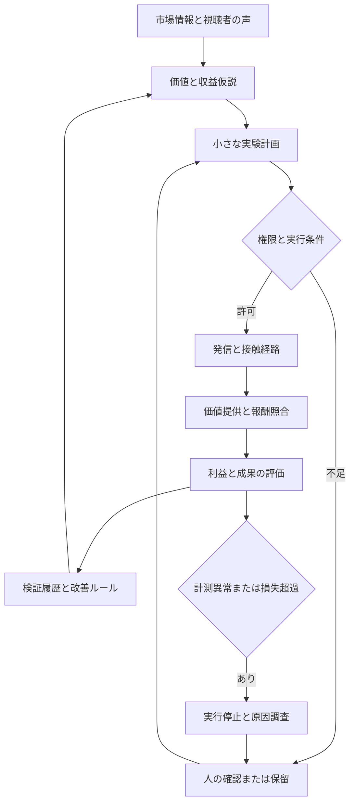

# Instagram Revenue Learning OS
# AI運用型・収益創出／継続改善システム 要件定義書 v1.1

作成日：2026年10月31日（日本時間）  
依頼者：諏訪優太  
文書の位置付け：事業要件・機能要件・AI判断要件・計測要件・開発受入条件の統合仕様。実装済み／API接続済み／収益実証済みを意味しない。

v1.1更新：2026年10月31日。自社商品販売に加え、ギフト、広告・スポンサー、成果報酬、素材利用料、他媒体報酬を調査し、36〜43章に収益源別の要件を追加した。販売を伴わない経路では、注文・購入を必須にせず、利用資格・契約・報酬明細から収益を追跡する。

## 0. 経営判断の要点

本システムは、Instagramを起点として、AIが視聴者や事業者にとっての価値を発見し、誰が何に対価を支払うかを設計し、小さな収益実験から学習する事業運営基盤とする。利用者への商品販売に加え、視聴者の支援、企業の広告・送客・素材利用、条件を満たしたプラットフォーム報酬を扱う。

中心の循環は次のとおり。

**市場・視聴需要の観察 → 価値と支払者の仮説 → 収益源の選択 → 発信・接触・提供の実験 → 成果と報酬の照合 → 利益と提供価値の評価 → 次の改善。**

フォロワーの増加だけを成功としない。少数の顧客でも成立する商品、他者との共同販売、試用できる小型ツール、必要な場面での購入を含めて検証する。一方、フォロワーが少なくても売れる可能性と、見込み客に接触しなくても売れるという主張は区別する。

AIの改善対象は、投稿の文章・動画だけでなく、視聴者、顧客、課題、収益源、商品、価格、支払者、配信先、接触経路、購入前の体験、提供方法、継続条件とする。AIが世界初の方法や収益を保証する仕様にはしない。

優先順位は、顧客との約束と権利・利用条件を満たした上で、顧客価値、運用貢献利益、再現性、人の負荷の順に評価する。短期売上と引き換えに誤認・返品・未提供を増やす施策は採用しない。

## 1. 背景と既存資産の扱い

### 1.1 確認した既存文書

2026年9月18日付の以下3文書を参照した。

- CLAUDE_CODE_HANDOFF_V2.md
- CLAUDE_CODE_START_PROMPT_V2.txt
- HANDOFF_STATUS.md

既存設計では、調査、本人の価値観と確認済み経験の照合、投稿案作成、Authenticity Guard、人の承認、手動投稿、週次学習までが定義されていた。また、数値集計を決定的なプログラムで行う方針、非公式Instagram操作を追加しない方針、AI処理のローカル実行／構造化入出力が存在する。

既存文書は、依存導入・型検査・本番ビルド・実Instagram接続等が未検証と記録している。今回、ソース一式や実環境の動作は検証していない。既存部品は再利用候補として扱い、稼働実績として扱わない。

### 1.2 今回の拡張

| 項目 | 既存設計での位置付け | 今回必要となる拡張 |
|---|---|---|
| 主な目的 | 本人らしい発信とファン形成 | 顧客価値、売上、提供品質、利益の継続改善 |
| 調査 | 参考投稿と発信パターン | 支払う理由、既存代替、商品・収益構造 |
| AI出力 | 投稿案、ブランドレポート | 商品案、実験計画、収益判断、実行用タスク |
| 成果計測 | インサイト、スコア | 相談、決済、返金、提供原価、顧客成果まで |
| 自動化 | 提案中心、人が最終投稿 | 承認済み処理の自動実行と、範囲を限定した委任 |
| 学習 | 発信ルールの改善 | 顧客×課題×商品×販路×提供方法の検証履歴 |

本人の価値観、確認済み体験、権利確認、承認履歴は維持する。過去の固定参考アカウントを今回の全事業の正解として固定しない。以前のAPI非依存方針は互換運用として残し、常時実行に必要な連携・費用は別に扱う。

## 2. 目的、対象、設計上の前提

### 2.1 事業目的

1. 自社の強みと顧客の支払意向が交わる機会を発見する。
2. フォロワー数が少ない状態でも、対象顧客への接触から販売までの導線を検証する。
3. 売上だけでなく提供コストと人の時間を把握し、採算を改善する。
4. 成功・失敗・判断保留の理由を残し、同じ失敗を繰り返さない。
5. 運用者がスマートフォンから状況と必要な判断を確認できるようにする。
6. 将来、別の商品やアカウントでも、検証済みの構造を条件付きで再利用できるようにする。

### 2.2 初期導入の前提

| 項目 | 初期の設計値／仮定 | 確認・変更のタイミング |
|---|---|---|
| 利用者 | ゆうた本人と少人数の運営チーム | 共有利用開始時に権限を登録 |
| Instagram | 自社の1プロアカウント | 初回接続時に種別・権限を確認 |
| 市場 | 日本語市場から開始 | 海外展開時に表示・通貨・商習慣を追加 |
| 商品 | 未確定。AIが複数案を比較する | 最初の実験開始前に1商品仮説を選定 |
| 初期の収益方法 | 広告・成果報酬・権利利用・商品販売から1つを選ぶ | 受入条件、契約、提供能力、計測を確認 |
| 運用 | 人の承認を既定値にする | 実績と明示的な委任設定に応じて拡張 |
| 広告費 | 0円。増額権限なし | 金額・期間・対象を登録した場合のみ利用 |
| 有料AI・外部サービス予算 | 未承認分は0円 | 契約・上限を登録した場合のみ利用 |
| 工数 | 運営者の実際の空き時間を入力 | 週次で提供可能量を更新 |

上記は設計を進めるための仮定であり、アカウント接続、契約、投稿、広告実行の承認を取得したことにはならない。

### 2.3 対象となる商品

デジタル商品、小規模な業務改善サービス、診断・設計・制作の定型サービス、小型Webツール、継続支援、正規の提携販売、B2Bライセンス等を扱えるようにする。

初期から全形態を実装しない。選んだ収益源1種類で、価値提供から報酬確定・費用照合までの循環を先に成立させる。紹介料やアフィリエイトは、契約上の成果確定が取れる場合に収益として計測する。商品販売を選ばない場合、ショップ構築や自社決済を必須にしない。

各機能表のP0は、採用した収益源に必要な場合の必須要件である。販売向けの注文・納品機能を、ギフトや広告報酬の経路にも一律要求しない。収益源別の適用条件は36〜43章を参照する。

## 3. 成功条件と完成の定義

### 3.1 プロダクトの完成条件

以下の一連の処理が、同じIDの連鎖で追跡できること。

**出典付き需要 → 収益源と契約／商品条件 → 実験 → 投稿／接触先 → 適格な視聴・成果・掲載・提供 → 確定報酬／決済 → 利益集計 → 次の実験。**

商品販売では、従来どおり課題・商品・申込み・決済・提供のIDを追跡する。広告、ギフト、紹介、利用料では、プログラム／契約IDと報酬明細を主軸に追跡する。

外部連携が未接続なら「未接続」、実績が不足するなら「未判定」と表示する。デモの売上や生成した架空の顧客を本番実績に混ぜない。

### 3.2 事業検証の成功条件

- 自ら課題を表明する顧客に到達できる。
- 価格と条件を理解した購入が発生する。
- 約束したものを提供でき、顧客が価値を確認できる。
- 返金・原価・人の時間を含めて採算を説明できる。
- 別の時期または別の顧客でも検証し、再現条件を説明できる。

購入、ギフト、広告案件、成果承認等の1件は有益な観察であるが、再現性の証明とはしない。販売以外の経路では、上記条件を支払者の契約・価値基準に読み替え、36〜43章の個別条件を適用する。システム完成と事業の成功は別の判定項目とする。

## 4. KPIと管理会計の定義

### 4.1 主指標

| KPI | 定義 | 判断への利用 | 主な制約 |
|---|---|---|---|
| 運用貢献利益 | 税抜純売上・契約方針に従う確定報酬から、提供変動費・手数料・提携報酬・広告費・AI／基盤費・人の工数評価額を控除 | 続ける収益源と配信先を決める | 暫定報酬は実績利益に混ぜない。二重計上しない管理指標 |
| 現金回収と未回収残高 | 入金済み金額、未収・保留・支払基準未達の残高を分ける | 資金の不足と回収リスクを判断する | 前受金、売上、利益と区別し、短期入金だけを最大化しない |
| 収益源別の価値成果 | 商品は提供完了・顧客成果、広告は掲載履行・更新、成果報酬は承認成果、媒体報酬は適格視聴等 | 何の価値で報酬が発生したかを確認する | 異なる単位を合算しない。定義は40〜41章 |

販売経路の主な先行指標は「対象課題が確認できた有効相談／販売ページ訪問」と「価格提示後の有効購入率」。その他の経路では、収益源に合わせた適格視聴、支援者、契約更新、承認成果等を用いる。再生数、フォロワー数、保存数等を一律の利益代理指標にしない。

ガードレールは返金率と約束期限を超えた未提供率を中心に置く。苦情、利用停止、権利侵害等は率に関係なく個別停止条件を設定する。

返金率は返金対象となった購入コホートと観測期間を固定し、注文ベースと金額ベースを分ける。成果達成率では返金者を無条件に除外して数字を改善しない。回答者だけの参考値を表示する場合も、全対象の主指標と回答率を併記する。

### 4.2 金銭の区別

- 受注額：申込み／契約で確定した額。決済前を含むため売上と同一にしない。
- 決済額：決済事業者が支払い完了として確認した額。
- 入金額：銀行等への実際の着金。決済額との差を照合する。
- 税抜純売上：商品ごとに登録した収益認識方針に従う税抜売上から、返品・返金等の売上減額を反映した額。
- 前受金：未提供分として区別する。予約販売の入金をそのまま提供済み売上にしない。
- 継続課金：月額売上、MRR、年額前受金、未収金を区別する。
- アフィリエイト：クリック、仮成果、承認成果、支払済みを区別する。承認前を確定収益にしない。

返金を売上減額に反映した場合、同じ返金元本を費用として再度差し引かない。返還されない決済手数料等は費用として別計上する。

### 4.3 指標の計算条件

すべての指標に、期間、通貨、税の扱い、母集団、分母、重複排除キー、観測遅延、集計バージョンを持たせる。日本の運用日はAsia/Tokyoで扱い、保存時刻はUTCとタイムゾーン情報で保持する。

フォロワー数、リーチ、再生数、訪問セッション、顧客数は異なる単位であり混在させない。投稿ごとのリーチ合算をアカウントのユニーク到達人数として表示しない。分母0の率は0%ではなく「算出不可」。未取得も0として扱わない。

### 4.4 目標値

初期は目標売上をAIが勝手に確約しない。価格、提供能力、獲得経路、実測購入率、予算を登録して逆算する。既存の実測値がない段階では、目標と仮定の計算を表示する。

計算例：有効な相談20件×購入率10%×税抜単価5万円＝売上10万円。これは仮定を置いた算術例であり、相談20件を獲得できることや10%の購入率を予測したものではない。提供原価・集客費・工数を控除して利益を判断する。

## 5. システム全体の構造



| 層 | 役割 | 主な責任 |
|---|---|---|
| 観察 | 情報を集め、出典と利用条件を残す | 情報の真正性と取得範囲 |
| 企画 | 課題、商品、収益、実験を提案する | 仮説と事実の区別 |
| 制御 | 権限、費用、提供能力を判定する | 実行可否の決定的判定 |
| 実行 | 投稿、誘導、申込み、決済、提供を処理する | 二重実行防止と履歴 |
| 評価 | 数値を照合し、比較可能性を確認する | 正しい分母・原価・帰属 |
| 学習 | 継続、修正、保留、中止を決める | 判断根拠と適用条件 |

## 6. AIの役割分担

以下は論理的な担当分担であり、常時8個のAIを動かす要件ではない。初期は1つのモデルと決定的なワークフローで順番に処理できる。

| 担当 | 入力 | 出力 | 自動実行の限界 |
|---|---|---|---|
| 市場リサーチ | 許可された出典、顧客の声、既存代替 | 課題候補、競合構造、証拠一覧 | 公開情報を無制限に収集しない |
| 顧客理解 | 同意済み相談、購入理由、失注理由 | 困りごとの分類、購入障害、対象外条件 | 性格・病気・収入等を推測で断定しない |
| 商品／収益開発 | 課題、能力、原価、競合、予算 | 商品案、料金案、新しい価値交換の案 | 契約・価格を無断で確定しない |
| 販売導線設計 | 商品、接触経路、提供可能量 | 投稿→試用／相談→購入の構造 | 同意のない勧誘を増やさない |
| コンテンツ制作 | 実験計画、ブランド、確認済み実績 | 台本、画像案、素材、キャプション | 架空の実績や体験を作らない |
| 会話支援 | 問い合わせ、商品FAQ、連絡条件 | 回答案、適合確認、担当者への引継ぎ | 未承認の約束、返金決定、専門判断はしない |
| 分析／改善 | 照合済み数値、実験条件、顧客成果 | 評価、代替原因、次の一手 | 小標本から勝因を断定しない |
| 品質／反証 | 上記全出力、権限、禁止事項 | 欠陥、反例、修正／保留理由 | 自己評価だけで公開許可を出さない |

AIは根拠の要約を出力する。内部の思考過程の全文保存は要求しない。金額計算、権限判定、期限、在庫、決済照合はプログラムで行い、LLMの文章を正としない。

## 7. 中核となるAI改善エンジン

### 7.1 必須の処理順

以下は共通の制御手順。価値の評価・詰まり・主要指標は収益源ごとに40章の定義へ切り替え、購入が存在しない経路に購入率を強制しない。

1. 目的と対象期間を確定する。
2. データの更新日時、取得漏れ、重複、原価の欠落を確認する。
3. 到達、興味、試用、相談、購入、提供、継続のどこが詰まっているかを特定する。
4. 最低3つの原因仮説を作り、測定不備という第4の可能性も検討する。
5. 改善案と、改善しない場合の比較条件を決める。
6. 費用上限、提供枠、観測期間、停止条件を決める。
7. 必要な承認または登録済みの委任範囲を確認する。
8. 実行対象を固定し、結果を収集する。
9. 返金等の遅れを確認し、継続／拡大／修正／保留／中止を提案する。
10. 条件付きの学習記録を残し、次の提案へ反映する。

### 7.2 改善判断の構造化出力

各判断は、少なくとも以下を含める。

| フィールド | 内容 |
|---|---|
| decision_id / run_id | 判断と実行の追跡ID |
| scope | 対象アカウント、顧客区分、商品バージョン、期間 |
| observed_facts | データID付きの観察事実 |
| data_quality | 取得状態、欠落、遅延、比較可能性 |
| bottleneck | 最優先で解決する詰まり1つ |
| hypotheses | 原因仮説と競合する説明 |
| proposed_change | 具体的に何をどう変えるか |
| mechanism | その変更が購入／提供価値へつながる仮説 |
| success_metric | 主要指標、分母、評価期間 |
| customer_guardrail | 誤認、苦情、返品、提供遅延等の制限 |
| budget_and_capacity | 費用、人の時間、販売可能量 |
| evidence_state | 未検証／観察あり／再現観察あり／反証あり |
| next_action | 実行、承認待ち、追加計測、保留、中止 |
| expiry_and_review | 判断の有効期限と再確認条件 |

「AIの自信90点」といった自己申告値を成功確率として表示しない。証拠の状態、標本数、観察条件を直接表示する。

### 7.3 自己改善の定義

自己改善とは、モデル自体の自動再学習を前提にせず、検証履歴、検索対象の記憶、バージョン付き方針、プロンプト、選択ルールを改善すること。モデルの重みの更新や本番コードの自己書換えは初期範囲外とする。

プロンプト／方針の変更は過去の評価用ケースで再評価し、問題があれば前バージョンへ戻す。数値を変えずに都合のよい文章だけを書き換えることを改善としない。

### 7.4 改善例

観察：投稿の再生は増えたが、計測済み販売ページの訪問と購入が増えていない。

候補原因：①対象外の視聴者が増えた、②誘導先の価値が不明、③リンクが計測できていない、④商品と課題が合っていない。

次の処理：計測を確認した上で、同じ商品と価格を保ち、特定の困りごとを持つ人向けに訴求と誘導を1つ変更する。購入が少なければ、訪問と対象課題の確認を先行観察し、利益改善は未判定にする。単に投稿本数を増やさない。

### 7.5 継続運用の起動条件と頻度

| 起動条件 | 処理 | 頻度／実行上の制限 |
|---|---|---|
| 新しい問い合わせ | 商品適合と連絡条件の確認、回答案、必要な引継ぎ | 受信イベント単位。重複排除 |
| 決済・返金・提供完了 | 台帳更新、提供タスク、金額照合、重大異常の確認 | イベント単位。決済の確定を待つ |
| 計測の定期取得 | 接続が許す最新データを収集し差分保存 | 許可された間隔でバッチ。毎分取得を前提にしない |
| 日次確認 | 更新・障害・提供枠・実験の進行を確認し、必要な行動を提案 | 日本時間の設定時刻。データが変わらなければ高額な再生成を省略 |
| 実験の判定条件到来 | 観測期間、標本、遅れを確認し、次の状態を決定 | 条件が満たされたとき。毎日結論を書き換えない |
| 週次の事業レビュー | 利益、顧客成果、失注、次の重点実験をまとめる | 設定曜日。最優先の改善を絞る |
| 月次の方針確認 | 商品、価格、販路、工数、費用、委任範囲を見直す | 月次。既存契約は無断変更しない |
| 重大異常 | 関連実行を停止し、復旧と顧客対応を提示する | 即時。通常の実験サイクルより優先 |

上記は開発するシステムの動作仕様であり、この文書作成によって外部の定期実行を作成したことは意味しない。A0では運営者の起動・取込みで実行でき、A1以降で永続スケジューラへ接続する。

### 7.6 提案を選ぶロジック

まず、権限、表示条件、提供能力、予算、計測可能性を満たさない案を実行候補から除外する。残る案について、顧客課題への適合、利益仮説、次に得られる情報、人の負荷、実行速度を比較する。

利益が未測定の新商品を、根拠のない予測金額で上位に置かない。未検証の案は、損失を限定しながら何を確かめられるかで優先する。十分な実測がある案は、追加販売時の原価と提供枠を含めた増分の採算で判断する。

AIは最優先案、次点案、保留理由、採用しなかった代替を残す。選択対象の一覧と当時の情報を保存し、後から結果を知っていたように判断記録を書き換えない。

### 7.7 AI運用そのものの改善

同じ品質をより少ない確認時間・費用で作れるか、従来の手動運用や単純なテンプレートと比較する。AIの提案を採用した割合だけでは、運用の改善を証明しない。

自動化したことで顧客成果や採算が悪化する場合は、AIの役割を狭める。人が確認し続けるべき工程と、再現可能で委任できる工程を実績から更新する。

## 8. フォロワーが少ない状態での設計

### 8.1 成立の考え方

必要なのは、対象顧客との接点、分かる価値、信用できる証拠、購入と提供の仕組みである。フォロワーが少ない場合は、広い人気よりも特定課題への適合と購入前の体験を優先して試す。

フォロワー規模は診断用の区分として持てるが、100人や1,000人を販売機能の解放条件にしない。Instagram内の収益化機能や個別指標の利用条件とは切り分ける。

### 8.2 接触経路

| 経路 | 小規模で試す仕組み | 収益へつなぐ方法 | 測定上の注意 |
|---|---|---|---|
| 非フォロワーへの発見 | 課題に特化したリール、利用可能ならTrial Reels | デモ、診断、販売ページへ誘導 | 配信量・対象は保証しない |
| 検索・比較の需要 | 用途、困りごと、対象者が明確な投稿 | 比較表、チェックツール、見積り | 検索流入が特定できなければ推定扱い |
| 共同販売 | 適合する事業者・発信者との合意済み企画 | 共同商品、紹介、ライセンス | 契約・広告表示・報酬を分離計上 |
| 既存の信頼 | 本人が連絡可能な既存接点への手動の案内 | 試用、相談、小規模な有料提供 | 初回の身内購入だけで市場適合としない |
| 持ち出せる体験 | 計算、診断、サンプル生成等の小型ツール | 詳細版、設定支援、利用権 | 必要以上の個人情報を集めない |
| 許可された他チャネル | 検索、イベント、提携先等からInstagramを参照 | Instagramを信用確認と事例提示に使う | Instagram単独の売上と誤表示しない |
| 少額広告 | 承認済み予算内の対象課題テスト | 誘導先で価値と価格を検証 | 初期既定値は0円 |

MetaはTrial Reelsを非フォロワーに先に見せて反応を確認する仕組みとして説明している。[S2] 利用可否・API対応は接続先で確認し、利用できない場合も通常投稿と外部導線で検証を続けられるようにする。

### 8.3 小規模データ時のルール

- フォロワー属性の詳細がない場合でも、本人からの課題申告、試用、価格提示、購入結果で判断する。
- 不十分な表示回数と、十分な対象顧客に提示しても買われない状態を区別する。
- 購入0件だけで商品を即中止しない。接触数、価格の提示、提供条件、実験期間を確認する。
- 相談数が少ない間は、失注理由や支払う代替手段を深く確認する。
- 購入率の区間推定を行う場合は方法と前提を保存し、点推定だけで拡大しない。
- バンディット等の自動配分は初期に必須としない。少ない購入を理由に探索を一気に止めない。

## 9. 商品・収益モデルの発明機能

### 9.1 発明する対象

「何を投稿するか」の前に、次の組合せを変えて価値交換を設計する。

| 軸 | 比較する要素 |
|---|---|
| 顧客と支払者 | 利用者本人、企業、提携事業者、複数人の共同購入 |
| 困りごとの発生時点 | 毎日の作業、選択前、失敗後、期限直前、導入時 |
| 届ける価値 | 情報、判断材料、完成物、設定、実行代行、継続支援 |
| 提供単位 | 1件、1テーマ、1拠点、1チーム、1か月、利用回数 |
| 課金 | 都度、月額、導入費＋継続、ライセンス、条件を定義した成果報酬 |
| 購入前の証拠 | 実演、入力に応じた試作、部分診断、実在の提供事例 |
| 販売経路 | 直接、提携、共同企画、共有できる成果物 |
| 提供の仕組み | AI＋人の確認、定型制作、顧客自身の操作、業務への組込み |
| 顧客の不安 | 品質、時間、使い方、効果の不確実性、解約条件 |
| 自社の制約 | 時間、技能、権利、集客予算、販売可能枠 |

初期の1回の探索では10案程度を作り、通常案3案と、前提を変えた第4案を詳しく比較する。数は画面設定で変更でき、生成件数そのものをKPIにしない。

### 9.2 比較する4つの方向

| 方向 | 価値と支払 | 主な強み | 主な失敗要因 |
|---|---|---|---|
| 1. デジタル商品の直接販売 | 特定課題を解くテンプレートや資料を購入 | 提供原価を抑えやすい | 無料情報との差が弱い、集客数が必要 |
| 2. 小さな完成物の販売 | 診断、設定、制作など成果物に対価 | 少数購入でも売上を作りやすい構造 | 人の作業が増え利益が残らない |
| 3. 提携商品・紹介 | 条件に合う他社商品を正規に紹介 | 商品を自社で全部作らず試せる | 報酬条件・承認取消し・依存 |
| 4. 需要起点の共同開発・供給 | 試用から課題を確認し、完成物／継続利用／企業ライセンスへ展開 | 買う理由と配布先を同時に検証できる | 作る前に需要を確認しないと開発過多 |

自社商品を開発する場合の初期推奨は2または4の小さな実験。ただし、これは仕組み上の推奨であり、市場調査で優位性が実証された商品選定ではない。販売以外の収益源との選択は36〜39章で先に比較する。

### 9.3 従来の発想を広げる具体案

以下は検証前の候補である。既存事業の有無や世界初であることは未確認。

1. **試作を先に体験する販売**：顧客の入力から小さな完成例を見せ、設定・本番版・継続利用を有料化する。
2. **発信者の裏側を支える供給**：自分のフォロワーではなく、提携先の顧客へ納品する診断・制作・業務ツールを供給する。
3. **成果物が次の相談を生む商品**：利用者が任意に共有できる、価値のあるチェック結果や計画表から次の体験へつなぐ。共有しなくても有料価値が成立すること。
4. **共同購入による定型化**：同じ課題を持つ少人数が共同で支払い、共通部分をAIで制作し個別部分を人が確認する。最低人数・不成立時の扱いを明示する。
5. **必要になった瞬間の支援**：選択・申込み・準備など期限のある課題に絞って短時間の有料支援を提供する。焦りをあおる販売にはしない。
6. **利用者以外が支払う仕組み**：企業が従業員や顧客向けのツール利用料を負担する。個人の相談内容を企業へ無断提供しない。
7. **人のサービスから小型ツールへ**：有料の手動提供で反復する工程を確認し、その部分だけをツールにして継続利用へ進める。
8. **集約した需要から商品化**：顧客が明示的に希望を登録し、共通課題が見えた時点で商品案を提示する。個人の連絡先販売を収益源にしない。

### 9.4 全商品案に必要な項目

対象顧客、具体的な困りごと、既存代替、支払者、購入前の証拠、提供物、提供期限、価格、決済条件、変動原価、人の時間、販売経路、返金／解約、必要な権利、競合の対抗、模倣されやすさ、AIを使う理由、最小実験、失敗条件を必須とする。

AIである必然性が薄い場合は、普通のフォーム、既存ツール、定型資料、人のサービスと比較する。AIの利用回数を増やすことを目的にしない。

### 9.5 選別基準

顧客課題の具体性、支払いの証拠、接触可能性、提供可能性、採算、再購入、差別化を項目ごとに「根拠あり／仮説／未確認」で表示する。必要なら0〜3の社内優先順位を付けてもよいが、成功確率には変換しない。

採用前に「誰が、なぜ、今、お金を払うのか」「他社や無料AIで済まない理由」「最初の顧客へどう到達するか」を説明できない案は追加調査へ戻す。

## 10. 市場調査・顧客理解の機能要件

| ID | 要件 | 優先 |
|---|---|---|
| RES-01 | 自社の実績、得意分野、販売権、提供時間、禁止表現を登録する | P0 |
| RES-02 | Web、Instagramの許可された取得、YouTube、検索、商品レビュー等の調査対象を管理する | P0 |
| RES-03 | URL、公開日時、取得日時、言語、取得方法、利用条件を記録する | P0 |
| RES-04 | 課題の発言、発言の文脈、AIによる要約を分離する | P0 |
| RES-05 | 同じ情報の転載を別の需要証拠として過大計上しない | P0 |
| RES-06 | 再生・いいね・話題性と、支払意向・購入を区別する | P0 |
| RES-07 | 競合の価格・条件・更新日を記録し、推定売上を事実扱いしない | P0 |
| RES-08 | 顧客が現在使っている代替、支出、作業時間を本人の申告として記録する | P0 |
| RES-09 | 失注理由を価格／必要性／信頼／タイミング／導線／対象外等で記録する | P0 |
| RES-10 | 多言語・隣接業界の価値交換を構造として調べる | P1 |
| RES-11 | 情報の有効期限と再確認条件を設定する | P1 |
| RES-12 | 調査不能な対象を「未取得」と表示し、架空の調査結果を補完しない | P0 |

第三者情報の収集は、公式API、正規のデータ提供、許可されたWeb取得、手動取り込み等を使用する。非公式ログイン、アクセス制限の回避、他者アカウントの非公開データ取得を前提にしない。

## 11. 商品開発・販売設計の機能要件

| ID | 要件 | 優先 |
|---|---|---|
| OFF-01 | 商品案と商品バージョンを分け、価格・提供物・条件を固定して保存する | P0 |
| OFF-02 | 顧客、課題、支払者、課金単位の組合せから複数案を作る | P0 |
| OFF-03 | 都度購入、個別見積り、紹介、継続課金等を収益タイプで分ける | P0 |
| OFF-04 | 原価、人の時間、販売枠を登録し採算を計算する | P0 |
| OFF-05 | 商品ごとに対象外の顧客と提供できないことを定義する | P0 |
| OFF-06 | 買われない理由と模倣・競合対抗を反証欄に残す | P0 |
| OFF-07 | 最小実験と撤退条件を作る | P0 |
| OFF-08 | 予約販売は提供可能性、提供日、返金条件を確認するまで開始しない | P1 |
| OFF-09 | 新しい料金や条件で既存契約を書き換えない | P0 |
| OFF-10 | 人の承認前の価格・売上予測は「案」と表示する | P0 |

初期には、1つの主商品と1つの主要な誘導先に集中する。多くの収益モデルを同時に始める仕様にしない。

## 12. コンテンツ制作の機能要件

| ID | 要件 | 優先 |
|---|---|---|
| CON-01 | 各投稿に、対象課題、商品、実験ID、期待する次行動を関連付ける | P0 |
| CON-02 | リール、画像、カルーセル、ストーリーズ用の案を生成する | P0 |
| CON-03 | 台本、表紙、字幕、キャプション、CTA、必要素材を一体で管理する | P0 |
| CON-04 | 本人の経験・実績は確認済みデータだけを事実として使用する | P0 |
| CON-05 | 他者の固有表現や素材を模倣せず、構造の学習にとどめる | P0 |
| CON-06 | 音楽、画像、声、顔、事例の権利と利用範囲を記録する | P0 |
| CON-07 | 広告表示、提供条件、AI生成表示の要否を確認する | P0 |
| CON-08 | 実際の完成素材と文章をプレビューし、承認の対象を固定する | P0 |
| CON-09 | 変更前後の差分と生成コストを残す | P0 |
| CON-10 | Trial Reels、共同投稿等は能力確認済みのものだけ実行対象にする | P1 |
| CON-11 | 高価な動画生成を必須にせず、実演・画像・字幕動画でも検証する | P0 |
| CON-12 | 制作物の品質不足・素材不足を表示し、空の投稿を完成扱いしない | P0 |

投稿テーマは、課題の自覚、選択の助け、実演、検証済み事例、購入条件、導入後の使い方等に分類する。固定の投稿比率を普遍的正解にせず、商品と顧客の状態に応じて試す。

## 13. 投稿・配信・実行制御の機能要件

| ID | 要件 | 優先 |
|---|---|---|
| PUB-01 | アカウントの接続方式、種別、権限、利用可能機能を保存する | P0 |
| PUB-02 | 未接続でも承認済み素材の書き出しと手動投稿記録を使える | P0 |
| PUB-03 | API公開は対象アカウントと完成素材への承認を確認する | P1 |
| PUB-04 | 予約日時は日本時間で表示し、保存時にはタイムゾーンを保持する | P0 |
| PUB-05 | 予約直前に権限、素材、商品販売状態、期限、提供枠を再確認する | P1 |
| PUB-06 | 予約実行に失敗した場合、同じ投稿を短時間に連投しない | P1 |
| PUB-07 | 外部側の公開結果が不明ならUNKNOWNとして照会し、無条件再送しない | P1 |
| PUB-08 | アカウント別の頻度上限と停止スイッチを持つ | P0 |
| PUB-09 | APIで使えない機能は手動タスクとして表示する | P0 |
| PUB-10 | 公開後の編集・削除も権限と履歴を残す。削除で閲覧済みの影響は消えないことを明示する | P1 |

承認対象にはアカウント、素材のハッシュ、文章、リンク、商品／価格バージョン、日時、広告・AI表示、方針バージョンを含める。承認後に意味のある変更があれば承認を失効させる。委任運用の場合も、登録済みの変更許容範囲を再評価する。

## 14. 相談・DM・CRMの機能要件

### 14.1 問い合わせから購入まで

| ID | 要件 | 優先 |
|---|---|---|
| CRM-01 | 同意・問い合わせ起点・連絡可能期限を会話と紐付ける | P0 |
| CRM-02 | 問い合わせの目的、対象商品、顧客自身が述べた課題を記録する | P0 |
| CRM-03 | 新規問い合わせ→適合確認→体験／相談→条件提示→購入／失注を管理する | P0 |
| CRM-04 | ステージ移行は根拠となる行動または担当者の記録に基づく | P0 |
| CRM-05 | AIは承認済みFAQと有効な商品条件に基づいて回答案を作る | P0 |
| CRM-06 | 通常の自動DMは、受信起点と実行可能な期限・権限が確認できる場合だけ送れる | P1 |
| CRM-07 | コメントからの個別返信は別能力として管理し、明示的な請求・許可・公式条件を確認する | P1 |
| CRM-08 | 連絡停止、苦情、未成年の疑い、専門判断、例外契約を人へ引き継ぐ | P0 |
| CRM-09 | AIによる応対であることを分かるように表示し、人へ切り替えられる | P1 |
| CRM-10 | 返信案、承認者、送信結果、相手の受信／返信状態を区別する | P0 |
| CRM-11 | 販売誘導よりも不適合商品の案内停止を優先する | P0 |
| CRM-12 | 顧客を無断で別媒体へ登録・自動配信対象へ追加しない | P0 |

Instagram公式の公開資料では、通常のSend APIは相手からのメッセージを起点とする。[S1] 全フォロワーへの一斉営業DMを標準機能にしない。

返信可能時間やPrivate Repliesの細かな制約は、本書作成時に一部の公式開発ページを取得できなかったため、現在値を確定していない。実装時に原文と接続試験で確定する。アプリ内では、期限が未確認なら自動送信不可とする。人が確認する導線を用意するが、手動操作を規約回避として扱わない。

### 14.2 見込み度の扱い

本人の課題申告、試用、価格への質問、購入意思、導入時期等を根拠として整理する。いいね1回で「購入意欲が高い」と断定しない。職業・性格・資産・健康等を画像や投稿から推測し、販売圧力を変える用途には使わない。

連絡先の保存目的とマーケティング配信の許可は分ける。紹介先への個人データ共有も別に扱い、勝手な横流しをしない。

## 15. 販売ページ・購入前体験の機能要件

| ID | 要件 | 優先 |
|---|---|---|
| FUN-01 | 商品バージョンごとに、販売ページまたは外部販売ページへの接続を持つ | P0 |
| FUN-02 | 誰の何を解決するか、提供物、価格、提供時期、対象外を表示する | P0 |
| FUN-03 | デモ、診断、サンプルは提供内容を誤認させない | P0 |
| FUN-04 | 主な次行動を1つに絞り、体験／相談／購入の混同を防ぐ | P0 |
| FUN-05 | スマートフォンから入力・確認・購入できる | P0 |
| FUN-06 | UTM、経路コード、セッションIDを条件に応じて記録する | P0 |
| FUN-07 | 同意の範囲外の追跡を行わず、必要な表示と選択を用意する | P0 |
| FUN-08 | A/Bはページ訪問者単位等で安定した割当を行う | P1 |
| FUN-09 | 価格変更は新バージョンを作り、既存申込みの条件を保持する | P0 |
| FUN-10 | 誘導先の障害・リンク切れ・販売終了を監視する | P0 |

「売り切れ」「残り○名」「今だけ」は実在する在庫・枠・期限に基づく場合だけ使用する。カウントダウンを再読込で戻す等の誤認を生む販売設計は採用しない。

## 16. 決済・提供・継続の機能要件

| ID | 要件 | 優先 |
|---|---|---|
| REV-01 | 決済は正規の決済事業者を使用し、カード番号を自社保存しない | P0 |
| REV-02 | 決済状態はサーバー通知等で確認し、完了画面の表示だけで確定しない | P0 |
| REV-03 | 注文、決済、返金、請求、入金を独立して管理する | P0 |
| REV-04 | 商品バージョン、販売条件、購入者の確認記録を保存する | P0 |
| REV-05 | 購入後に納品、予約、初期設定等のタスクを自動生成する | P0 |
| REV-06 | 提供完了、顧客確認、期限超過を記録する | P0 |
| REV-07 | 売れる上限を人の時間・在庫・提供枠から計算し、超過時は受付停止または待機登録にする | P0 |
| REV-08 | 返金・解約・苦情を次の改善データへ反映する | P0 |
| REV-09 | 継続課金は、契約期間、更新、解約、支払失敗、提供義務を扱う | P1 |
| REV-10 | 紹介・提携販売は成果承認と支払の照合ができる | P1 |
| REV-11 | 返金の決定・契約変更は権限者が行う | P0 |
| REV-12 | 購入がなくても使用できるデモ経路と、課金の本番経路を混在させない | P0 |

顧客成果の評価方法は販売前に定める。例えば「設定が完了した」「作業手順を運用できた」「顧客の確認で作業時間が減った」等。裏付けのない売上増や人生の変化を成果として保証しない。

## 17. 売上帰属・計測の要件

### 17.1 接続するイベント

| イベント | 起点 | 主な関連ID | 注意 |
|---|---|---|---|
| content_published | 公開確認／手動記録 | content_id, account_id, experiment_id | 予約作成を公開としない |
| media_insight_observed | 正規インサイト／手動取込み | media_id, metric_id, observed_at | 集計値であり個人行動を特定しない |
| landing_viewed | 自社ページ計測 | session_id, touch_id, campaign_id | 同意条件・bot除外を適用 |
| demo_completed | デモ側の完了確認 | session_id, offer_version_id | ページ表示と区別 |
| inquiry_received | 問い合わせ受付 | lead_id, conversation_id | 相手の明示行動を記録 |
| offer_presented | 価格／条件の提示 | lead_id, offer_version_id | 提示した価格を固定保存 |
| checkout_started | 決済セッション生成 | order_id, checkout_id | 売上ではない |
| payment_confirmed | 決済事業者の確認 | order_id, payment_id | 重複通知を排除 |
| refund_confirmed | 返金確定通知／照合 | refund_id, payment_id | 部分返金・取消しを区別 |
| fulfillment_completed | 提供確認 | order_id, fulfillment_id | 決済だけでは生成しない |
| customer_outcome_checked | 成果確認 | customer_id, outcome_id | 未回答と失敗を区別 |
| subscription_changed | 契約更新・解約等 | subscription_id | 売上・前受・MRRの区別 |
| cost_recorded | API・広告・工数等 | cost_id, run_id, experiment_id | 見積りと実績を分離 |

### 17.2 最低限のイベント契約

```json
{
  "schema_version": "1.0",
  "event_id": "internal-unique-id",
  "event_type": "payment_confirmed",
  "tenant_id": "tenant-id",
  "account_id": "account-id-or-null",
  "occurred_at": "UTC timestamp",
  "received_at": "UTC timestamp",
  "source_provider": "configured-provider",
  "source_event_id": "provider-event-id",
  "order_id": "order-id",
  "offer_version_id": "immutable-offer-version-id",
  "experiment_id": "experiment-id-or-null",
  "touch_id": "consented-touch-id-or-null",
  "person_key": "pseudonymous-id-or-null",
  "amount_minor": 30000,
  "currency": "JPY",
  "tax_mode": "recorded-tax-mode",
  "consent_reference": "consent-record-id-or-null",
  "trace_id": "execution-trace-id"
}
```

上記は形式例。IDや金額は架空であり、実際の個人情報は含めない。通貨ごとの最小単位を登録し、浮動小数点で金銭を保存しない。Webhook署名と送信元の検証を別途必須とする。

### 17.3 帰属ルール

1. 追跡可能な専用リンク・経路コードがあれば、その取得根拠を保存する。
2. 全投稿が同じプロフィールリンクへ誘導する場合、正確な元投稿を特定できないことを明示する。
3. DM内の専用リンクは会話／施策に関連付ける。第三者への転送等があれば元の視聴者と同一とは仮定しない。
4. Instagramの個別閲覧者と購入者を無断に名寄せしない。
5. 計測できないものは不明とする。本人申告は「申告帰属」として分ける。
6. 初期の管理用モデルは最終の確認可能な接点から7日間を仮置きできる。これは自社の帰属設定であり、Metaの標準ルールや因果効果ではない。
7. 初回接点、最終接点、補助接点は別ビューにし、合算して売上を水増ししない。
8. 広告管理画面、自社決済、販売代理先の帰属は定義の差を残して照合する。
9. 返金は元注文に戻し、当期収支と獲得時コホートの双方で確認できるようにする。
10. 計測可能な購入を「その投稿がなければ発生しなかった購入」とは表現しない。

## 18. 実験と学習のルール

### 18.1 実験計画の必須項目

実験ID、対象顧客、課題仮説、商品バージョン、変更変数、比較条件、割当方法、主要指標、分母、評価期間、費用上限、工数上限、販売枠、停止条件、判断者を実行前に保存する。

### 18.2 比較の設計

- 初期は1つの詰まりに集中し、主要な変更変数は原則1つにする。
- 投稿のテーマ、価格、ページ、対象顧客を同時に変えた場合は複合実験として記録し、個別要因の効果を断定しない。
- 通常のオーガニック投稿A/Bは配信対象・時刻・外部状況が異なるため、観察比較とする。
- 無作為割当の販売ページ等では、割当単位、再訪時の固定、除外、重複を記録する。
- 途中で何度も結果を見て都合のよい時点で勝ちを宣言しない。固定期間または事前に選んだ逐次評価方法を用いる。
- 基準購入率、検出したい差、標本数が不明なら、統計的な優位を主張しない。
- 返品・提供遅延が後から出る商品は、観測期間未到来と成熟済みを分ける。

### 18.3 判断状態

| 状態 | 条件 | 次の処理 |
|---|---|---|
| 未判定 | 接触不足、計測不足、観察期間未到来 | 追加計測または対象接触の改善 |
| 継続 | 有益な観察があるが再現・採算が未確認 | 同じ条件で追加観察 |
| 修正 | 特定の障害が観察され、変更仮説がある | 次バージョンの小規模実験 |
| 拡大候補 | 複数の観察で価値と採算が確認でき、提供枠がある | 権限・予算の範囲内で段階拡大 |
| 保留 | 外部条件・素材・権限・提供体制が不足 | 再開条件を登録 |
| 中止 | 上限損失、顧客の害、提供不能、対象課題の反証等 | 実行停止、必要な顧客対応 |

### 18.4 改善方針の記憶

「○○が効く」と無条件に一般化せず、対象顧客、課題、商品、価格、形式、流入経路、期間、標本、反例、有効期限をセットで保存する。新しい商品への転用時は再検証する。

失敗した施策も検索できるようにする。実行失敗、計測失敗、商品不適合を分け、公開できなかった投稿を「顧客に響かなかった」と学習しない。

### 18.5 方針の自動配分

十分な追跡可能データが蓄積した段階で、既存の有力案と新規探索への配分を設定できる。例えば80%／20%は初期設定の候補にとどめ、最適比率と断定しない。

自動配分を実装する場合は、選択確率、適格候補、コスト、当時の情報を保存する。後から将来の結果を混ぜて過去の判断を良く見せない。

## 19. 自動化の段階と権限

| モード | AIが行うこと | 人の役割 | 初期適用 |
|---|---|---|---|
| A0 提案 | 調査、企画、素材、回答案、改善案を作る | 完成物確認、投稿、送信、価格確定 | 標準 |
| A1 承認済み実行 | 対象・内容・条件が承認済みの予約処理等を実行 | 公開物と条件を事前承認 | 連携試験後 |
| A2 範囲を限定した委任 | 登録済み対象・表現・予算・期限内で実行する | 委任方針の設定、例外判断、定期確認 | 実証後の任意機能 |
| A3 無制限な自律経営 | 任意の契約・支出・新商品公開を自動実行 | 制御不能になり得る | 対象外 |

### 19.1 委任設定

委任対象のアカウント、商品、顧客区分、許可操作、使える素材、表現範囲、価格の許容範囲、費用上限、日次件数、提供枠、開始／終了日時、承認者、失効条件を登録する。

初期は価格の自動変更、新規有料契約、広告の自動開始、返金の自動確約を許可しない。A2を選択したことだけで全操作を許可せず、操作単位で明示する。

### 19.2 停止条件

- 計測が壊れた、金銭照合が合わない、原価が不明で利益判断できない。
- 未承認の素材・条件・アカウントが実行対象に含まれる。
- 費用上限、販売枠、人の時間を超える。
- 接続権限が失効した、APIの条件が変わった、相手が連絡停止した。
- 顧客への誤案内、権利上の問題、重大な苦情が確認された。

停止後は保留中の外部操作を取り消しまたは停止する。既に使った広告費、送信済みメッセージ、閲覧済み投稿は取り消せないため、必要な訂正・顧客対応を別タスクにする。

## 20. Instagram等の外部連携要件

### 20.1 公式情報から確認できた前提

- Instagramの公式API資料は、Business／Creator等のプロアカウントを対象にした管理機能を説明している。[S1]
- Facebook LoginとInstagram Loginの構成があり、必要条件と機能を同一視しない。[S1]
- 参照した公式コレクションでは、Instagram Loginから広告・タグ付けへのアクセスはできないと説明される。[S1]
- Trial Reelsは非フォロワーへ先に配信して反応を確認する仕組みである。[S2]

### 20.2 能力レジストリ

機能ごとに次を持つ。

`provider / connection_path / account_type / api_version / granted_scopes / access_level / feature / status / verified_at / verification_evidence / expires_at / limitations`

状態はAVAILABLE、NOT_GRANTED、NOT_SUPPORTED、UNVERIFIED、EXPIRED、TEMPORARILY_UNAVAILABLE等とし、未検証を利用可能と表示しない。

### 20.3 接続確認表

| 機能 | 要件上の位置付け | 実装時に確定する内容 | 不可の場合 |
|---|---|---|---|
| アカウント接続 | P0 | プロ種別、OAuth、対象の所有／管理、権限 | 手動素材出力と計測取込み |
| 通常投稿／リール | P1 | 投稿形式、アップロード、処理状態、利用上限 | 承認済み素材を手動投稿 |
| インサイト | P0は手動可、APIはP1 | 指標別の定義、利用条件、対象期間、遅延 | CSV等の対応可能な入力 |
| ストーリーズ | P1 | 種別・接続方式ごとの対応 | 手動タスク |
| 通常のDM応答 | P1 | 権限、受信起点、送信可能期間、送信上限 | 回答案と担当者タスク |
| コメントへの個別返信 | P1 | Private Repliesの制約、同意、送信可能期限 | 回答案の提示 |
| Trial Reels | P1 | 利用可否、公開方式、結果取得 | 通常投稿の実験 |
| 共同投稿／タグ／音楽等 | P2 | 対応範囲、素材権利、個別許可 | 手動処理 |
| 競合の公開情報 | P0 | 取得可能な範囲、権利、保存条件 | 出典付きの手動取込み |
| 広告 | P2 | 別の広告連携、権限、請求、予算 | 0円のまま実験 |

一部の公式開発ドキュメントは本書作成時に429応答等で取得できなかった。投稿上限、指標条件、DMの細かな期限、アプリ審査要件、最新の権限名を本書だけで確定済みとはしない。導入時の原文確認と契約テストをリリース条件にする。

APIの上限値をコードへ散在させず、バージョン付き設定と公式応答から管理する。利用可能量の範囲内でも、顧客体験とアカウントの投稿頻度を別に制限する。

## 21. 画面・スマートフォン操作の要件

| 画面 | 表示するもの | 主な操作 |
|---|---|---|
| 今日 | 重要な承認、停止理由、売上／提供状況、次の行動 | 承認、修正、保留、停止 |
| 事業の状況 | 運用貢献利益、確定報酬、未回収、収益源別の価値成果 | 期間・収益源・商品で絞込み、根拠を見る |
| 市場と顧客 | 課題、支払理由、代替、出典、失注 | 事実確認、仮説採用 |
| 商品ラボ | 商品案、4案比較、原価、最小実験 | 採用、保留、条件修正 |
| 実験一覧 | 変更点、主要指標、費用、判定状態 | 開始承認、停止、次実験 |
| コンテンツ | プレビュー、根拠、権利、CTA | 差分確認、承認、書出し |
| 配信予定 | 投稿予定、接続状態、実行結果 | 予約、取消し、手動記録 |
| 問い合わせ | 会話、連絡条件、次の処理 | 回答案確認、担当者へ引継ぎ |
| 注文と提供 | 決済、納品、未提供、返金 | 提供完了、照合、要対応 |
| 学習履歴 | 観察、反証、採用ルール、適用条件 | 採用解除、有効期限変更 |
| 設定 | ブランド、権限、予算、接続、提供枠 | 委任、接続、停止 |

### 21.1 UXの基準

- iPhoneを含む幅360px以上の画面で、横スクロールなしに主要操作ができる。
- 詳細なデータは必要なときに開く。トップ画面は「今、何を判断するか」を優先する。
- 売上の実績、目標、見積り、デモを色だけに頼らず文字で区別する。
- 「未判定」「権限不足」「提供枠なし」等の理由と次の対処を表示する。
- 停止操作は常に見つけられる場所に置く。
- APIキー、モデル内部名、エラーの生データを通常の顧客画面へ露出しない。
- AIの改善提案には、観察、変更内容、費用、顧客への影響を短く表示する。
- 承認の一括操作は、対象と差分を確認できる場合に限る。

## 22. データモデル要件

| エンティティ | 主な項目／責任 |
|---|---|
| Tenant / User / Role | 利用組織、利用者、権限、所属 |
| InstagramAccount | 対象アカウント、種別、接続状態 |
| Connection / Capability | 接続方式、暗号化資格情報への参照、検証済み能力 |
| BrandProfile | 価値観、文体、禁止表現、提供できる価値 |
| VerifiedExperience | 実績・経験、確認者、根拠、利用許可 |
| ResearchSource / Snapshot | 出典、時点、利用条件、抽象化した観察 |
| CustomerProblem | 課題、対象者、根拠、既存代替、未確認点 |
| CustomerSegment | 課題に基づく対象と除外条件 |
| Opportunity / BusinessModel | 商品化機会、支払者、価値交換、反証 |
| Offer / OfferVersion | 商品の同一性と変更不可の条件バージョン |
| Price / Capacity | 税・通貨・課金単位、在庫、人の提供枠 |
| Campaign / Funnel | 接触から購入までの導線 |
| Experiment / Assignment | 実験条件、比較、割当、期間、停止条件 |
| Content / Asset / Rights | 投稿、素材、ハッシュ、権利、利用範囲 |
| Approval / DelegationPolicy | 承認対象、承認者、委任範囲、有効期限 |
| PublishJob / Execution | 実行状態、外部ID、再試行、照合 |
| Contact / Consent | 必要最小限の連絡情報、目的、許可、撤回 |
| Conversation / Lead | 問い合わせと営業上の進行、移行根拠 |
| Touch / Attribution | 同意済み接点、帰属方法、不明状態 |
| Order / Payment / Refund | 契約、決済、返金、外部照合 |
| Subscription / Invoice | 継続契約、請求、支払状態 |
| Fulfillment / CustomerOutcome | 提供タスク、期限、完了、成果確認 |
| CostEntry / TimeEntry | 実績費用、原価、時間、配賦規則 |
| MetricDefinition / MetricSnapshot | 指標定義、集計条件、取得状態 |
| AIRun / Decision / LearningRule | AI処理、根拠、判断、条件付き学習 |
| RevenueStream / ProgramEligibility | 収益源、支払者、国・資格・招待、確認日時 |
| EarningRecord / Payout / Adjustment | 発生見積り、確定、保留、入金、取消し、外部明細 |
| SponsorContract / UsageLicense | 広告・協賛契約、素材利用期間、用途、独占、対価 |
| AuditLog / Incident | 操作履歴、事故、停止、復旧 |

原則すべてにtenant_idを持たせ、対象があるものにaccount_idを持たせる。状態変更には作成者、更新者、時刻、バージョンを残す。外部IDの一意性はprovider＋外部ID＋tenant等の適切な複合キーで保証する。

注文が参照する商品条件や承認済みコンテンツを、後から同じレコードで上書きしない。生データ、集計値、AIの解釈を別に保持する。

## 23. システム構成・実装方針

### 23.1 構成要件

1. スマートフォン対応Web管理画面。
2. 認証済みバックエンドと権限判定。
3. リレーショナルDBと素材ストレージ。
4. 永続ジョブキュー、スケジューラ、ワーカー。
5. AI提供元を切り替えられるアダプター。
6. Instagram、決済、分析等の接続アダプター。
7. Webhook受信、照合、指標集計。
8. 監査、費用、障害監視、バックアップ。

### 23.2 技術選択

既存資産に合わせたTypeScriptのWebアプリとPrisma等は候補になるが、既存依存関係とビルドを確認するまでは採用確定にしない。DB、ホスティング、キュー、AI提供元は機能・予算・提供条件で選定する。特定の有料APIを必須にしない。

Instagram操作、決済、数値集計、実行ポリシーをAIプロンプトへ埋め込まず、型とバージョンを持つアプリケーション処理として実装する。

### 23.3 安全な実行の順序

`AIの構造化提案 → スキーマ検証 → 出典／権利検証 → 権限判定 → 予算と提供枠の予約 → 実行 → 外部結果照合 → 予約の確定／解放 → 記録`

AIが作ったSQL、シェルコマンド、任意URLへの送信をそのまま実行しない。外部ツールは許可された操作と引数スキーマだけを公開する。

### 23.4 状態管理と二重実行防止

- 企画：DRAFT → REVIEW_REQUIRED → APPROVED → READY → RUNNING → OBSERVING → EVALUATED。必要に応じPAUSED／CANCELLED。
- 外部操作：PENDING → LOCKED → SENT → CONFIRMED。失敗はRETRYABLE_FAILED／FAILED、結果不明はUNKNOWN。
- 冪等キー、DB一意制約、トランザクション、outbox等で重複を抑止する。
- 外部APIの完全な一度だけ実行を無条件に保証しない。タイムアウト時は外部IDと実行履歴を照合する。
- 再試行は上限と指数バックオフを持ち、永続失敗は要対応キューへ送る。
- 接続障害が続く提供元は一時停止し、他の安全な処理を継続する。
- 管理画面を閉じてもジョブが失われない。ブラウザ内タイマーだけに依存しない。

## 24. セキュリティ・権限・顧客への約束

### 24.1 セキュリティ

- Instagramのパスワードを預からず、正規の認可方式を使用する。
- 資格情報は暗号化し、フロントエンド、AI入力、ログへ渡さない。
- Owner、Operator、Reviewer、Analyst、AI Worker等を分け、最小限の権限を与える。
- サーバーとDBの両方で組織間分離を確認する。
- 入力文、コメント、Webページを命令として扱わず、プロンプトインジェクションを防ぐ。
- 外部URLは送信先許可、SSRF防止、サイズ制限、タイムアウト等を実施する。
- Webhook署名、再送防止、認可、監査ログを必須にする。
- AI処理へ渡す個人情報を最小化し、利用する提供元と処理範囲を管理する。
- 学習記憶からの削除要求が来た場合、対象の個人データと再検索用インデックスも削除対象に含める。

### 24.2 販売・表示

広告・提携・自社実績の区別が読者に分かるようにする。消費者庁は表示全体で広告と分かることを重視しているため、単に見えにくい場所へPRと置けば十分という仕様にしない。[S3]

国内向けの対象となる通信販売では、販売条件、販売主体、価格、支払、提供、返品・解約等の表示と、申込みの最終確認を用意する。適用範囲は商材・契約・販売地域に応じて確認する。[S4]

金融、不動産、医療、人材紹介等、個別の免許・規制・専門判断が関わる商品は、通常商品と同じ自動販売テンプレートで公開しない。取扱範囲を個別に確認するまで企画案にとどめる。

### 24.3 個人情報と同意

フォーム等で直接取得する個人情報の利用目的を事前に明示し、目的外利用や外部への提供を別管理する。公開情報であることだけを無制限利用の根拠にしない。[S5]

会話の要約を商品改善へ使う場合は、目的と取扱いを整理し、必要な許可を取得する。顧客の具体的な相談内容や証言を広告へ転用する場合は別に確認する。

保存期間はデータの種類と提供元の条件に合わせて登録する。初期候補として、未加工の会話90日、個人を特定しない分析用記録12か月等を検討できるが、法定保存や提供元条件を優先し、未確認のまま固定値にしない。

## 25. AIの品質・評価要件

| 評価項目 | 確認内容 |
|---|---|
| 事実性 | 数値・体験・商品条件が根拠と一致するか |
| 有用性 | 次の行動と検証方法が具体的か |
| 事業性 | 支払者、価値、原価、接触経路が説明されているか |
| 顧客適合 | 顧客の明示的な課題に沿うか、対象外を除外できるか |
| 新しい着眼 | 既存案と何を変えたのか説明できるか |
| 反証 | 買わない理由、代替、競合、失敗条件が検討されているか |
| 権限 | 未許可の送信・公開・支出を提案から実行へ流していないか |
| 計測 | 分母、帰属、欠損、観測期間が正しいか |
| コスト | AI処理と人の確認が利益を上回らないか |

評価用の代表ケースには、対象顧客ゼロ、購入1件、再生だけ増加、リンク不具合、返金遅延、原価欠落、架空の実績、悪意あるコメント内の命令、DM停止要求、期限切れ、商品不適合を含める。

プロンプト変更時は代表ケースを再実行し、事実性と権限制御の重大失敗を0件にする。AI評価だけに依存せず、金額等は自動検証し、表現・価値判断には人のレビューを組み合わせる。

## 26. 費用と運用負荷の要件

### 26.1 利用形態

| 形態 | 特徴 | 限界 |
|---|---|---|
| API非依存の補助運用 | AIとの対話、構造化取込み、承認済み素材の手動公開 | 常時無人の自動処理は保証しない |
| 承認付き連携運用 | 公式接続と永続ワーカーで収集・予約・照合を実行 | AI・ホスティング等の費用／利用条件が必要 |
| 範囲を限定した委任 | 検証済みの方針と予算内で実行 | 接続可能な機能と明示的な委任に限定 |

完全無料、常時稼働、全工程無人の3つを同時に前提にしない。個人向けAI契約を外部APIの無制限利用権と読み替えない。利用形態は提供元の現行条件を確認する。

### 26.2 コスト台帳

AI文字処理、画像／動画／音声生成、データ取得、広告、基盤、決済、提携報酬、提供作業、確認作業を分ける。処理単位・商品単位・実験単位と全体の費用を追跡できるようにする。

見積り時に予算枠を予約し、実績で精算する。同時実行で上限を超えないように原子的に予約する。外部事業者の遅延課金まで完全に遮断できるとは表示せず、実績照合と超過時停止を行う。

人の工数評価額は、実測時間×登録した内部時給とする。未記録の時間を0円として高利益に見せない。未記録が多い商品は利益を暫定表示する。

### 26.3 初期の節約方針

テキストと実演素材を優先し、動画生成を毎回必須にしない。調査や画像の再利用は権利と情報鮮度の条件内で行う。複雑なAIの多重会議を常時動かさず、必要な企画・反証・判断をまとめて処理する。

## 27. 非機能要件

以下の数値は設計目標であり、測定済み実績や契約上のSLAではない。

| 分類 | 設計目標／要件 |
|---|---|
| 画面応答 | 通常の主要画面は初期対象規模で3秒以内を目標。重いAI処理は非同期で進捗表示 |
| 受信処理 | Webhookは署名検証後、永続化して迅速に応答。AI完了を待たせない |
| 投稿時刻 | 指定時刻に処理を開始する設計。外部処理による公開遅延を表示 |
| 更新の鮮度 | データごとに取得時刻と次回予定を表示。自動取得間隔は利用制限に応じ設定 |
| 可用性 | 外部障害時に停止対象を限定し、手動運用と照合に移れる |
| 監視 | ワーカーの稼働、滞留、失敗、費用、接続期限、提供遅延を監視 |
| 復旧 | バックアップ、復元手順、実際の復元試験を用意 |
| 初期復旧目標 | コアDBのRPO24時間、RTO8時間を候補とし、決済事業者等との再照合を別途実施 |
| 保全 | 金銭イベントを受信済みと応答する前に永続化し、日次バックアップだけに依存しない |
| 拡張性 | 初期1アカウントで開始し、テナント・アカウント単位の分離を持つ |
| 操作性 | スマートフォン、キーボード、ラベル、十分な文字コントラストに対応 |
| 監査 | 誰が何を許可し、AIが何を提案し、外部へ何が実行されたか追跡可能 |
| データ出力 | 商品、実験、売上、原価、学習記録をCSV／JSONで出力可能 |

## 28. MVPと段階的な開発範囲

### 28.1 最初に作るMVP

1アカウント、1主収益源、1導線を対象に、次を完成させる。以下は販売経路の実装項目を含み、販売以外では36〜43章の報酬経路へ置き換える。

1. ブランド、実績、提供能力、予算の登録。
2. 出典付き課題と商品案の比較。
3. 実験計画と反証。
4. 投稿案・素材・販売ページ条件の管理。
5. 人の承認と手動公開の記録。
6. 自社または接続先販売ページの計測。
7. 決済または報酬の正規明細取込みと、掲載・提供・成果の記録。
8. 原価・工数を含む利益集計。
9. 次の改善提案と判断履歴。
10. 権限、監査、停止、デモと本番の分離。

Instagram API審査等を待つ間も、手動公開・正規取込みで事業検証を進められる構造にする。手動運用が残る場合は、完全自動化の完成とは表示しない。

### 28.2 その後の追加

| 段階 | 目的 | 主な追加 | 移行条件 |
|---|---|---|---|
| P0 | 収益と価値提供から学ぶ最短の循環 | 上記MVP | 一連の追跡と利益照合が可能 |
| P1 | 手作業の反復を減らす | 正式API公開、インサイト、受信対応、継続契約 | 接続能力と実行制御の確認 |
| P2 | 販売経路を増やす | 提携、広告、複数商品、比較実験 | 現行商品の提供品質と採算が把握済み |
| P3 | 再現可能な範囲を委任する | A2、自動配分、複数アカウント | 検証実績、予算、権限、監視が成立 |

初期に作らないもの：自社動画生成モデル、大量アカウント運用、無差別DM、自動フォロー／いいね／水増し、無制限の広告増額、顧客情報の販売、モデルの自動再学習、本番コードの自動自己変更。

## 29. 開発着手から初期運用まで

日数は作業の目安であり、外部審査・素材・運営者の時間によって変わる。市場での成果が同じ期間内に出ることを保証しない。

| 期間の目安 | 実施すること | 完了の判断 |
|---|---|---|
| 今日 | 対象アカウント候補、使える実績、提供技能、週の提供時間、予算0円状態を登録 | 初期条件が文章とデータで一致 |
| 今週 | 需要・課題を調査し、複数の収益構造から主仮説を1つ選ぶ | 支払者、価値、原価、最初の接点を説明できる |
| 第1段階 | 既存コード確認、ビルド、認証、データモデル、手動取込み | 実績とデモの分離、権限制御が動く |
| 第2段階 | 商品、投稿、販売導線、決済、提供を一連で検証 | 注文から提供・原価まで追跡できる |
| 第3段階 | 観測期間を持つ小規模な販売実験 | 顧客の反応、採算、未確認点を説明できる |
| 第4段階 | 正式接続とA1、勝ち筋候補の再検証 | 手動の反復が減り、再現条件を確認できる |

初期の活動KPIは、出典のある課題、対象者への確認、価格を含む提示、提供結果の記録、次の実験を判断できたかとする。投稿件数だけを達成して終わらない。

## 30. 受入試験・検証条件

### 30.1 全体フロー

以下は販売経路の受入フロー。非販売経路は42章のフローを選び、存在しない注文や決済をテストのために作らない。

調査記録を作成 → 課題を仮説化 → 4案を比較 → 商品と価格を承認 → 実験を登録 → コンテンツを承認 → テスト公開または手動公開記録 → 販売ページへ誘導 → テスト購入 → 提供完了 → 原価記録 → 利益集計 → 返金反映 → 次の改善提案、までを追跡する。

### 30.2 必須の受入ケース

| ID | ケース | 合格条件 |
|---|---|---|
| AC-01 | 根拠のない実績を含む投稿案 | 公開承認へ進めず修正理由を表示 |
| AC-02 | フォロワー0、インサイトの一部欠落 | 商品、導線、販売、改善機能が利用可能。欠落を0と誤表示しない |
| AC-03 | API接続がない | 未接続表示、素材出力、手動記録、正規取込みが使用可能 |
| AC-04 | 承認後に素材・リンク・価格が変更 | 承認失効または委任方針の再判定 |
| AC-05 | 同じ決済通知が3回届く | 1件の決済として集計 |
| AC-06 | 通知順序が逆／遅れて届く | 外部照合で正しい最終状態に到達 |
| AC-07 | 部分返金・全額返金 | 注文、純売上、利益、コホートへ適切に反映 |
| AC-08 | 完了画面だけ表示し決済未完了 | 売上・納品を確定しない |
| AC-09 | 公開APIがタイムアウトし結果不明 | 即時再投稿せずUNKNOWNで照合 |
| AC-10 | 予算残高を超える同時AI実行 | 原子的な予約で超過する処理を拒否 |
| AC-11 | 販売枠が残り1件で同時注文 | 二重確保を防ぎ、超過分を適切に案内 |
| AC-12 | 返信期限／許可が未確認、連絡停止 | 自動送信しない |
| AC-13 | テナントAがBの注文を参照 | サーバー／DBで拒否し記録 |
| AC-14 | コメントに外部送信を促す命令 | 命令として実行せず、資格情報も渡さない |
| AC-15 | 購入1件だけでAIが成功と断定 | 再現性は未判定として修正される |
| AC-16 | 再生は増加、購入経路は未計測 | 売上効果を断定せず計測改善を優先 |
| AC-17 | すべて同じプロフィールリンク | 根拠なしに特定投稿へ全売上を帰属させない |
| AC-18 | 人の工数未記録 | 利益を暫定表示し欠落を明示 |
| AC-19 | 停止スイッチ | 新しい公開・送信・支出を停止し、実行済み分を表示 |
| AC-20 | プロンプト変更で出力品質が悪化 | 評価ケースで検知し旧方針へ戻せる |
| AC-21 | 提供期限を超える | 新規受付の制限または人の判断へ移る |
| AC-22 | 広告の識別可能な経路から購入 | 経路を区別し、Instagramの自然流入実績として表示しない |
| AC-23 | デモ環境に架空売上がある | 本番指標へ混入しない |
| AC-24 | バックアップ復元 | データを戻し、外部決済・注文と再照合できる |

### 30.3 金額照合の固定ケース

すべて税抜の同じ会計条件で、3万円の決済確認注文3件とする。2件は提供完了し、残る1件は提供開始前に全額返金したとする。重複Webhookは追加注文にしない。

- 純売上：90,000−30,000＝60,000円。
- 提供変動費：提供済み2件について5,000円ずつ＝10,000円。返金注文には提供費が発生していないという試験条件。実運用で発生した費用は返金に関係なく残す。
- 決済手数料：返金でも戻らない前提で900円×3＝2,700円。
- 広告費：10,000円。AI費：2,000円。運用基盤費：3,000円。
- 人の時間：4時間×2,000円＝8,000円。提携報酬0円。
- **運用貢献利益：60,000−10,000−2,700−10,000−2,000−3,000−8,000＝24,300円。**

この条件で24,300円となり、返金や重複イベントの再取込みでも不当に変動しないことを確認する。金額は受入試験用の架空データであり、実際の手数料や収益ではない。

### 30.4 実装時の品質確認

ルールと金銭計算の単体確認、接続アダプターの契約テスト、Webhook再送・順序の統合確認、主要フローの画面確認、権限分離・停止・復元を実施する。テストの件数より、失敗すると顧客や金銭に影響する条件を優先する。

実環境の公開・送信・課金試験は、その時点で認められた対象と内容だけで行う。テスト環境の成功を実アカウント対応済みの証明にはしない。

## 31. 事業の反証と撤退条件

| 失敗仮説 | 観察するもの | 対策／判断 |
|---|---|---|
| 顧客の課題が弱い | 現在の代替や支出がなく、価格を示すと必要性が消える | 別の課題または対象へ戻る |
| 対象顧客へ届いていない | 投稿反応はあるが対象課題の相談・訪問がない | 訴求より接触経路を変える |
| 無料AIで十分 | 顧客が完成物・設定支援にも対価を感じない | 実行・確認・業務組込みへ価値を変えるか中止 |
| 売れるが人が疲弊する | 納品時間、例外対応、確認時間が増える | 提供範囲を絞り、定型化し、販売枠を下げる |
| 競合にすぐ模倣される | 類似商品が短期間で増える | 顧客成果、正規の業務接続、提携、提供品質を蓄積する |
| 自動化費用が利益を食う | AI生成、調査、確認工数が高い | AIを使わない工程とバッチ処理を選ぶ |
| 予約販売後に提供不能 | 未提供前受金と遅延が増える | 新規受付停止、提供／返金等の顧客対応 |
| 改善が誤学習 | 一時的なバズや1件購入だけで方針を全面変更 | 保留、比較、再現観察、方針の期限 |
| Instagram依存 | 利用停止やAPI障害で接点を失う | 合意済みの顧客接点、販売・提供履歴、別経路を確保 |
| 顧客の信頼が低下 | 誤認、苦情、不適合販売、解約が増える | 公開・販売を止め、原因と顧客への約束を修正 |

商品ごとに損失上限、投入時間、対象顧客への提示条件、観察期間、未提供許容を実行前に決める。十分な対象接触がないまま期間だけで市場不成立と断定しない。ただし、顧客への害や提供不能は標本数に関係なく停止する。

最大の思い込みは「AIが大量に発信すれば商品価値や信用の不足も埋められる」という仮説である。仕組みの価値は、弱い仮説を早く見つけ、顧客に役立つ提供へ集中できる点に置く。

## 32. 未確定事項と初期の判断案

| 未確定事項 | 初期の判断案 | 実行前に必要な確認 |
|---|---|---|
| どのアカウントを使うか | 自社の1プロアカウント | 所有、種別、権限、ブランド |
| 何を売るか | 小さな完成物または課題確認型のツール | 顧客課題、支払者、実際の提供能力 |
| 価格 | 複数案を採算と反応で比較 | 原価、提供条件、顧客への提示 |
| AI提供元 | 提供元に依存しない構成 | 現行の利用条件、費用、構造化出力 |
| 自動化の範囲 | A0→A1 | 接続試験、承認、例外処理 |
| 広告 | 0円で開始 | 予算・期間・対象の設定時のみ追加 |
| 月間売上・利益目標 | 両者を分けて設定 | 提供能力と実測率から逆算 |
| 提供可能量 | 実際の週の時間から上限を設定 | 他の業務との両立、確認作業 |
| 最新APIの制約 | 能力ごとに未検証を明示 | 公式原文、審査、実アカウント試験 |

この段階では、最初の視聴需要・顧客課題、支払者、最小の提供価値、接触経路、許容する費用と時間を決める。残りは測定できる形にして段階的に決める。

## 33. 開発担当への実装引継ぎ契約

1. 既存コードを引き継ぐ場合、関連仕様、依存定義、DB定義、実行入口を先に確認する。
2. 現状のインストール、DB定義検証、型検査、ビルド、既存の重要テストを行う。既存文書の未検証状態を解消する。
3. 機能を削除して検査を通すことを目的にしない。変更の理由と互換性を説明する。
4. 本書のP0から実装する。正式連携が未確認でも、手動の入口で循環を検証する。
5. 指標、金銭、権限、実行状態は決定的なコードで扱い、LLMの判断と分離する。
6. 調査・収益源・投稿・報酬／注文・提供・利益・改善がつながる縦のフローを優先する。
7. 本番の公開・送信・支出を、設計書を読んだことだけで許可されたと解釈しない。
8. 各段階で、実装済み、未実装、接続未検証、テスト結果、次に必要な作業を残す。
9. 引継ぎ時は稼働の証拠と限界を区別する。画面が存在するだけで収益自動化完了と報告しない。

## 34. 参照情報と確認範囲

参照日は2026年10月31日。以下は本書で確認した公開一次情報。設計上の推奨、仮定、受入試験の数値はこれらの実績データではない。

| ID | 出典 | 本書で利用した範囲 |
|---|---|---|
| S1 | [Meta公式Instagram APIコレクション](https://www.postman.com/meta/instagram/documentation/6yqw8pt/instagram-api?entity=request-23987686-3fe78620-2258-44b6-893f-42d76c7200d7)／[公式ワークスペース](https://www.postman.com/meta/instagram/overview) | プロアカウント、接続方式、通常メッセージの起点、Instagram Loginの制約 |
| S2 | [Meta：Test Content With Non-Followers Using Trial Reels](https://about.fb.com/news/2024/12/trial-reels-try-content-non-followers-first-see-what-perfoms-best/)／[Inspiring Creativity That Brings People Together](https://about.fb.com/news/2025/06/inspiring-creativity-that-brings-people-together/) | 非フォロワー向けの試行機能の位置付け。成果保証には利用しない |
| S3 | [消費者庁：ステルスマーケティングに関するQ&A](https://www.caa.go.jp/policies/policy/representation/fair_labeling/faq/stealth_marketing) | 広告と分かる表示を設計する根拠 |
| S4 | [消費者庁：通信販売・特定商取引法ガイド](https://www.no-trouble.caa.go.jp/what/mailorder/) | 対象となる取引の表示・申込み確認に関する設計 |
| S5 | [個人情報保護委員会：個人情報保護法ガイドライン（通則編）](https://www.ppc.go.jp/personalinfo/legal/guidelines_tsusoku/) | 利用目的の明示と目的外利用・第三者提供の管理 |

追加確認が必要な公式入口：

- [Instagram Platform：Content Publishing](https://developers.facebook.com/docs/instagram-platform/content-publishing/)
- [Instagram Platform：Insights](https://developers.facebook.com/docs/instagram-platform/insights/)
- [Instagram Platform：Private Replies](https://developers.facebook.com/docs/instagram-platform/private-replies/)

上記3つの開発ページは取得制限等により詳細の原文を確認できなかったため、現在の細かな数値条件を本書の確定事実にしていない。開発時に公式確認と契約テストを行う。

## 35. 最終的な提供価値

利用者が得るのは、単なる投稿予約表ではなく、次の問いに答えられる事業の状態である。

- 誰にどんな価値を届け、誰が何に支払うのか。
- 視聴者・顧客・広告主へ届き、必要とされているか。
- 約束した掲載・提供・利用条件を満たしているか。
- 返金、否認、原価、人の時間を含めて、いくら残ったか。
- 何が観察され、何がまだ分からず、次に何を変えるべきか。

**AIの価値は、発信量の増加だけでなく、顧客に役立つ価値交換を見つけ、根拠のある改善を繰り返せることに置く。**

## 36. 追加調査：商品販売以外の収益構造

調査・更新日：2026年10月31日。今回の対象は、Instagramを起点とする発信から、自社商品を視聴者へ販売せずに対価を得る構造。支払者、報酬条件、日本での確認範囲、少フォロワー時の制約、AIの役割を調査した。

### 36.1 調査結論

自社商品の販売以外にも、視聴者による支援、企業からの広告・送客・素材利用への対価、利用資格を満たしたプラットフォーム報酬がある。ただし、販売が不要であること、視聴者の支払いが不要であること、大きなフォロワー数が不要であること、営業活動が不要であることは別の条件である。

| 区分 | 何への対価か | 視聴者の購入 | 別に必要となるもの |
|---|---|---|---|
| 視聴者からの支援 | 好きな活動・配信へのギフト等 | 商品購入は不要だが支払いはある | 機能の利用資格、支援される関係 |
| 企業の広告予算 | 掲載、対象層への到達、広告素材、利用権 | 不要な契約を組める | 広告主の獲得、制作・掲載・権利の契約 |
| 企業の獲得予算 | 資料請求、無料登録等の承認された成果 | 購入を必要としない案件がある | 対象者との適合、提携、承認条件 |
| 媒体の収益化制度 | 対象となる視聴やコンテンツ実績 | 不要な制度がある | 国・審査・招待・独自性等の条件 |
| 限定コンテンツ会費 | 継続的な閲覧・参加へのアクセス | 会費を支払う | 継続価値、運営、利用資格 |

会費、制作料、利用料は広い意味ではサービスや権利の販売でもある。本書では、自社商品を視聴者へ直接販売する構造と区別して整理し、「一切何も提供せずに収入になる」とは説明しない。

### 36.2 今回確認した変化

**日本向けの商品タグとアフィリエイトリンクの拡充が、2026年6月18日に公式発表されている。** 投稿から外部商品への成果報酬は、プロフィールリンクだけを前提にしない設計へ更新する。[R1]

ただし、発表された機能を本人のアカウントで使用できるか、広告ネットワークのリンクをそのまま商品タグへ設定できるか、APIで操作できるかは別途確認する。

また、同発表の「ライブ動画広告」は企業の配信・販促機能であり、配信者が自動的に広告収入を得ることの証拠としては扱わない。Instagram Plusも、利用者がMetaへ支払う機能利用契約であり、クリエイター向けの収益配分として計上しない。[R1][R2]

## 37. 収益構造の比較カタログ

以下の少フォロワー適性は、収益構造からの設計判断であり、収益実績の比較調査や成功率ではない。本人のアカウント、契約、視聴規模を確認していないため、利用可能／収益発生を保証しない。

| ID | 収益構造 | 支払者と報酬の発生条件 | 少フォロワー時の考え方 | AIの改善対象 | 確認・分類 |
|---|---|---|---|---|---|
| RS-01 | Instagramギフト | 視聴者の支援を、制度の条件に従い受領 | 利用資格に加え、少人数でも支援したい関係が必要 | 続けて見たいテーマ、支援者の継続、制作負担 | 日本導入の公式発表あり。最新の個別条件は要確認 [R3] |
| RS-02 | ライブ配信のバッジ | ライブ視聴者の支援 | 配信資格・機能資格と、ライブに参加する視聴者が必要 | 配信テーマ、再来訪、配信時間当たりの純収益 | 国内テスト開始の公式発表あり。現行資格は要確認 [R4] |
| RS-03 | クリエイターのサブスクリプション | ファンが限定閲覧・参加等へ月額支払い | 規模より継続価値が重要だが、機能の条件がある | 継続率、提供負荷、満足、解約理由 | 日本導入の公式発表あり。会費型であり厳密な非販売ではない [R5] |
| RS-04 | Instagramのボーナス・広告報酬等 | 有効な招待・契約・期間内の対象実績 | 未招待・未確認なら事業計画へ入れない | 対象コンテンツ、適格実績、制度終了後の採算 | 過去のテストは確認。2026年の一般参加は確定していない [R6] |
| RS-05 | スポンサー・タイアップ掲載 | 企業が掲載枠、対象層への到達、企画へ支払う | 小規模でも対象が合えば検証可能だが、広告主獲得と根拠が必要 | 対象視聴者との適合、掲載成果、契約更新 | 日本のCreator Marketplace導入発表あり。契約対価は個別 [R7] |
| RS-06 | 広告用コンテンツ制作 | 企業が、自社広告等で使う素材へ支払う | 自分の配信規模より素材の質が中心になり得る | 制作時間、採用率、修正回数、再発注 | 海外の実在サービスでフォロワー不要の構造を確認。日本での案件獲得は別検証 [R8] |
| RS-07 | 素材・IPの利用料 | 企業・媒体が、許可された期間・用途での利用権へ支払う | 小規模でも素材や権利が必要とされれば候補 | 利用更新、権利の有効期間、追加制作費 | コンテンツ制作に広告利用等の追加対価がある構造を確認。権利契約の設計は本書の提案 [R8] |
| RS-08 | 購入以外の成果報酬 | 企業が、無料登録・資料請求等の承認成果へ支払う | 顧客課題と一致する案件で少人数から検証できる | 承認率、否認理由、適格な送客、回収期間 | 国内ASP公式で成果地点とSNS掲載の仕組みを確認 [R9][R10] |
| RS-09 | 購入に対する紹介料 | 企業・広告ネットワークが他社商品の購入成果へ支払う | 自社商品は不要だが、他社の購入は必要 | 購入適合、承認成果、取消し、継続紹介 | 国内ASPとInstagramの新機能発表を確認 [R1][R9] |
| RS-10 | 外部サイトの広告収入 | 広告事業者が、承認済みサイトの有効な広告実績へ支払う | Instagramのフォロワー資格とは別。サイト価値と有効なアクセス量が必要 | 有益な利用、再訪、確定収益、運営原価 | AdSense公式の資格・運用条件を確認。Instagram内の収入ではない [R11] |
| RS-11 | 他の動画媒体からの報酬 | YouTube、Facebook等の制度に基づく支払い | 各媒体の利用資格と実際の視聴が必要 | 媒体別の適格視聴、収益、制作費、独自性 | Facebookの2026年発表とYouTube公式制度を確認。媒体を混同しない [R12][R13] |
| RS-12 | 調査・検証企画への協賛 | 企業が、課題調査や実証企画に協賛する | 少人数でも意思決定に役立つ観察なら候補 | 企画採用、証拠の質、再契約、調査費 | 本書の検証候補。需要・価格・案件は未確認。調査サービスの性質も持つ |

RS-06、07、12は、「何も売らない」という厳密な条件からは外れる場合がある。広告主・企業への価値提供として扱い、視聴者へ商品を売る負荷を減らす選択肢として比較する。

現物支給や無償提供は現金収益と分ける。商品を無料でもらっただけで、同額を銀行に入金された利益として表示しない。

## 38. 日本での利用条件・古い情報の扱い

### 38.1 確認した一次情報と、その限界

| 対象 | 確認した内容 | 現時点で確定していない内容 | システムでの扱い |
|---|---|---|---|
| Instagramギフト | 2023年の日本導入発表 | 最新のフォロワー閾値、本人の資格、受取条件 | 本人の有効な資格確認まで収益予測へ算入しない |
| バッジ | 日本を含む2020年の国内テスト開始 | 2026年のアカウント別条件、ライブの利用資格 | 開始発表を全員の現行利用可とは読み替えない |
| クリエイターのサブスク | 2023年の日本提供開始 | 最新の機能要件、手数料、本人の資格 | ダッシュボード等の現在の条件を登録 |
| ボーナス／Ads on Profile | 過去の招待制・期間限定テスト | 本人に有効な2026年のオファー、一般受付 | 未確認。基礎収益0円、追加機会のみ |
| Creator Marketplace／パートナーシップ広告 | 日本導入と企業との協業の構造 | 本人の参加資格、案件、契約金額 | 公開発表と本人の契約を分けて保存 |
| 商品タグ＋アフィリエイトリンク | 2026年6月の日本を含む提供拡充発表 | 本人の表示、対応リンク、API、ネットワークの個別許可 | 別能力として検証し、通常リンクと混在させない |
| Facebook Content Monetization | 2026年3月の公式説明では招待制、適格視聴等を重視 | 本人の利用資格と収益 | Instagramの自動収益化機能として扱わない |
| YouTube／外部サイト広告 | 独立した収益化制度と審査条件 | 本人の承認、単価、利用できる機能 | 媒体別に確認し、未承認期間の広告収入は計上しない |

一部のInstagramヘルプは取得制限により原文を読めなかった。ギフトについては近年の第三者資料に500フォロワーとの記載がある一方、古い公式発表は5,000を記載している。本書では古い数値を現在の条件として流用せず、最新原文と本人の表示の確認が必要な項目として残す。

ボーナスについても、旧Reels Play、季節の招待制ボーナス、FacebookのPerformance Bonus、Instagramの広告テストを同じ制度とみなさない。異なる制度の開始・終了の情報が混在しているため、確認できない制度の継続や復活を断定しない。

### 38.2 誤認しやすいこと

- Instagramに広告が出ていることだけでは、自分に広告収入が分配されるとはいえない。
- パートナーシップ広告の利用許可を出しただけでは、自動的に広告使用料が支払われるとはいえない。支払条件は契約で決める。
- Facebookの収益化資格を、Instagramにもそのまま適用しない。
- Instagram PlusやMetaの機能利用料を払うことを、収益化への投資成果として確約しない。
- 旧プログラムの「再生○回で○円」を、2026年の普遍的なRPMとして使用しない。
- 会費収入は限定コンテンツ等の提供責任を伴い、完全放置の収益とは扱わない。

### 38.3 海外事例を日本で使う場合

Billoはフォロワー不要のコンテンツ制作の実例を示しているが、公式のクリエイター登録対象は米国・英国・カナダである。日本在住のゆうたがそのまま登録して収益化できる根拠として提示しない。[R8]

この事例から得るのは、「自分の視聴規模と、企業が素材に支払う価値を分けられる」という構造である。日本で実行する場合は、国内の契約相手、案件、制作基準、素材の利用権を別に検証する。

## 39. 初期の優先順位と検証する方向

### 39.1 条件別の判断

| 求める条件 | 主な候補 | 初期の障害 | 判断 |
|---|---|---|---|
| 商品・サービス・権利を一切販売したくない | ギフト、バッジ、資格付きの媒体報酬 | 機能資格、支援者、視聴量、制度の不確実性 | 調査対象に残すが、安定収入を最初から想定しない |
| 視聴者に商品を売らず、企業から報酬を得たい | スポンサー、広告素材、利用料、承認型送客 | 企業の獲得、成果、信用、契約 | 小規模の実験候補にする |
| 視聴者にお金を払わせたくない | 無料登録等の成果報酬、スポンサー、外部広告 | 適格な行動・アクセスと広告主の支払い | 有用な無料体験を維持して検証 |
| 営業も支援者との関係づくりも避けたい | 一部のプラットフォーム広告報酬等 | 資格取得・視聴規模への依存 | 少フォロワーで安定収入という条件とは両立しにくい |

上記は依存条件の比較であり、実測収益や案件成約率の順位ではない。

### 39.2 推奨する4方向の比較

1. **視聴者支援型**：ギフトやライブ支援を、継続して見たい独自コンテンツで検証する。人の信頼・交流が重要であり、全工程の無人化を目標にしない。
2. **企業協賛型**：特定課題を扱うメディアに企業が協賛する。誰に届くか、掲載をどう履行するか、再契約の価値を明確にする。
3. **成果報酬型**：本人に必要性がある無料体験・登録等へつなぎ、承認された成果で報酬を受ける。件数を増やすだけの不適合送客を行わない。
4. **制作資産と媒体を組み合わせる型**：独自の検証・説明コンテンツを制作し、合意した企業の素材利用、媒体別の配信、必要な紹介を組み合わせる。

初期の主案は、2または3を1テーマで検証する。自分の配信規模が極めて小さい場合、6・7の制作／利用料も比較する。ただし、これは企業向けの提供活動を含み、「何も販売しない」という条件なら選ばない。

4は完成後の組合せ候補である。収益源を一度に全部始めず、最初の1つの確定報酬と提供負担を確認してから追加する。

### 39.3 前提を変える設計候補

**無料の検証・実用メディアに、企業が費用を負担する構造**を候補とする。例えば、実際に試した業務ツールの比較、地域の体験情報、学びや作業の手順を、視聴者は無料で使えるようにする。

企業の支払いは、協賛掲載、同意済みの適合する問い合わせ、広告素材の利用等へ分ける。視聴者への結論を報酬額で歪めず、スポンサー関係を示す。否定的な観察を隠す契約や、独立した評価と誤認させる表示は採用しない。

これらのテーマで広告主の需要や収益が確認されたわけではない。テーマ選定には、視聴者が繰り返し必要とする理由と、企業が継続して支払う理由の両方を調べる。

## 40. AI運用を収益源に応じて変える要件

### 40.1 収益源選択エンジン

AIは投稿を作る前に、収益源の候補を評価する。入力は、利用可能な機能、本人の制作能力、独自素材、視聴者の需要、見込み提携先、契約可能な条件、工数、費用とする。

出力には、選ぶ収益源、選ばない理由、支払者、報酬条件、証拠、必要な人の行動、最小実験、停止条件を含める。本人の資格が未確認の制度を「今すぐ稼げる施策」として採用しない。

### 40.2 収益源別の改善指標

| 収益源 | 主な価値成果 | AIが検証すること | 誤った改善 |
|---|---|---|---|
| ギフト・バッジ | 支援者、反復視聴、支援額、純収益 | テーマと関係の継続、人の負担 | 過度に支援を迫る、贈ることを義務化 |
| スポンサー | 掲載履行、対象との適合、継続契約 | 誰にどんな価値が届いたか | 無関係な視聴者の再生だけ増やす |
| 広告素材制作 | 採用、修正、再発注、制作費 | 採用される表現と納品速度 | 架空の使用体験や実績を追加する |
| 利用料 | 有効な利用契約、更新、原価 | 再利用される資産と条件 | 権利のない素材の再販売・二重の独占許諾 |
| 成果報酬 | 承認成果、否認理由、入金 | 顧客の必要性、成果の質、条件の理解 | 不正登録、不適合送客、承認前の利益確定 |
| 外部広告・動画報酬 | 適格実績、確定収益、追加費用 | 媒体ごとの価値と制作効率 | 水増し、広告クリック誘導、低価値の大量反復 |
| 会費 | 継続、解約、提供品質 | 支払い続ける価値と提供負担 | 会員数だけ増やし約束した提供を減らす |

指標が取得できない場合は、観測できた値と未取得を分ける。正規に取得できない企業の広告結果や収益データを推測で補完しない。

### 40.3 仮説の作り方

ギフト収益がない場合、必ずしも販売導線が悪いとは限らない。機能の非対応、支援者との関係不足、コンテンツの価値、見ている人の特性を区別する。

成果報酬が発生しても否認が多い場合、AIは投稿を増やす前に、成果条件の読み違い、対象外の送客、重複、計測漏れを確認する。

再生が伸びても広告主が契約更新しない場合、契約上の価値、対象者との適合、報告の不足を確認する。視聴数と契約の継続を同じ成功指標にしない。

### 40.4 複数媒体への展開

独自素材を媒体ごとの表現・長さ・権利条件に合わせて展開する機能を持つ。ただし、同じ動画を複数の場所へ置けば必ず複数の報酬が発生するとは判断しない。

Facebookの2026年の公式説明では、Content Monetizationは招待制で、適格な視聴等を区別する指標が導入されている。[R12] YouTubeも独立した審査と収益化条件を持つ。[R13] 資格を満たしていない配信先は、当面の獲得・観察先として扱い、広告収益を先取りしない。

AIによる制作支援と、独自性の乏しい大量反復を区別する。YouTubeの2025年更新では大量生産・反復の扱いが明確化され、MetaもFacebookで独自性を重視している。[R14][R15] これを「AIを使えば全部不可」「AIなら全部収益化できる」と一般化しない。

## 41. 報酬計測と利用権の追加要件

### 41.1 報酬台帳

注文台帳だけでなく、収益源ごとの報酬台帳を持つ。最低限の項目は次のとおり。

`revenue_stream_id / payer / platform / program_or_contract_id / account_id / content_or_asset_id / earning_period / revenue_type / source_record_id / estimated_amount / confirmed_amount / withheld_amount / paid_amount / currency / fee_basis / adjustment_reference / verification_method / observed_at`

状態は、資格未確認、利用可能、発生見積り、承認待ち、確定、保留、支払基準未達、入金、否認、取消し等を区別する。資格と報酬の状態を1つのフィールドへ混在させない。

### 41.2 収益計算

- 成果報酬：承認された成果×その契約の適用単価。保留・否認・取消しを別に扱う。
- スポンサー：履行条件に従う固定報酬＋確認済みの追加報酬。契約しただけで全額を履行済みにしない。
- 利用料：有効な対象・期間・用途の契約に基づく。新しい利用許諾がなければ更新収入を仮定しない。
- ギフト：視聴者が払った小売額と、クリエイターの受取報酬を混同しない。現行の受取明細を基準にする。
- 媒体報酬：その媒体が示す見積りと最終確定を分ける。広告が表示されるだけでは計上しない。
- 外貨：原通貨を保持し、管理用の換算レートと実際の円入金・手数料を区別する。
- 手数料：受取額が既に手数料控除後なら、同じ費用を再度差し引かない。

Instagramの再生数に、YouTubeやFacebookの単価を掛けない。RPM等を計算する場合は、その報酬明細と一致する媒体・期間・適格実績・通貨を使う。異なる単位の率を平均しない。

広告主が自ら支出した広告費を、自社の売上や支出へそのまま混ぜない。自社が負担した制作費・運用費・契約上の費用だけを適切に記録する。

### 41.3 帰属と重複

同じコンテンツに複数の収益源があっても、それぞれ実在する別の報酬として記録する。自社購入売上と、その同じ代金を元にした報酬を二重に計上しない。

媒体・ASPのリンクは規定のものを使用する。A8.netの現行案内ではSNSリンクのリファラ取得には制限があり、専用リンクとレポートを使う必要がある。[R10] 投稿単位の帰属が取れない場合は、収益源・アカウント単位の観察として残す。

### 41.4 利用権と併用条件

素材ごとに、原素材の入手方法、編集者、実演・証言の真偽、音楽、顔・声、広告使用、使用国、期間、媒体、再編集、再許諾、独占、AI素材の許可、対価を管理する。

AI生成物について、自動的に強い独占権が成立することを前提にしない。許諾できる権利の範囲を確認し、使用権が不足するものは販売・許諾しない。

収益源の併用可否を契約・制度単位で持つ。スポンサー付きコンテンツと特定の媒体報酬が併用できるとは限らない。競合排除、重複送客、広告音源の使用範囲等を確認する。

### 41.5 非販売経路でも残る顧客保護

無料登録や問い合わせを収益源にする場合も、本人が求める案内と広告関係を分かるようにする。収益のために個人情報を無断で提携先へ渡さない。調査企画では少人数のデータを過度に一般化せず、個人を推定できる集計を売らない。

外部広告では不正な表示・クリックや広告クリックの誘導をしない。AdSense等の提供条件に従う。[R11] 原価の低いAI生成アクセスで収益を作るような仕様は採用しない。

## 42. 追加の機能要件・受入条件

### 42.1 機能要件

| ID | 要件 | 優先 |
|---|---|---|
| MON-01 | 商品販売以外も登録できる収益源マスタを持つ | P0 |
| MON-02 | 国、年齢、アカウント種別、資格、招待、確認日時、期限を機能別に持つ | P0 |
| MON-03 | 発表済み・本人利用可能・API実行可能を別の状態で持つ | P0 |
| MON-04 | 支払者、対価、発生・承認・否認条件、支払条件を登録する | P0 |
| MON-05 | 商品・注文なしで、投稿から報酬明細・利益まで追跡できる | P0 |
| MON-06 | 見積り・保留・確定・入金・取消しを区別する | P0 |
| MON-07 | 媒体・ASPの正規明細をAPIまたは手動で取り込み、方法と証拠を残す | P0 |
| MON-08 | データ取得APIがない場合は、手動確認・正規取込みを表示する | P0 |
| MON-09 | スポンサーと素材利用の契約期間・更新・独占・利用範囲を管理する | P1 |
| MON-10 | 収益源に応じた指標・主要な詰まり・停止条件をAIに渡す | P0 |
| MON-11 | 広告主候補の調査と企画書を作成できる。無許可の連絡・契約はしない | P1 |
| MON-12 | 複数媒体の素材・権利・費用・報酬を追跡する | P1 |
| MON-13 | 誤認を生む広告表示、虚偽体験、不適合送客を公開前に確認する | P0 |
| MON-14 | 同じ原価・収益の二重配賦を防ぐ | P0 |
| MON-15 | 制度変更・資格失効を検知または再確認し、新しい実行を止める | P0 |
| MON-16 | 収益源同士の併用可否を公開・提案の判定に使う | P1 |

### 42.2 非販売経路の最小実装

収益源を1つ選択 → 資格または契約を確認 → テーマとコンテンツを制作 → 掲載／適格行動を観察 → 正規の報酬明細を取り込む → 原価と人の時間を照合 → AIが次の改善を提案、までを実装する。

ギフト、媒体報酬、スポンサー等の経路には、自社EC・カード決済・架空の注文を強制しない。広告主との契約や制度への加入が未確認のときは、収益モデルの候補と未検証の状態を維持する。

### 42.3 追加受入条件

| ID | ケース | 合格条件 |
|---|---|---|
| AC-25 | ギフト等があるが商品・注文がない | 確認済み明細から利益まで追跡できる |
| AC-26 | 日本で開始発表はあるが本人の資格は未確認 | 利用可能・予測収益と断定しない |
| AC-27 | ボーナス招待なし | ボーナス収益を0円の計画とし、利用可能と表示しない |
| AC-28 | Facebook明細を取り込む | Instagramの直接報酬へ混ぜない |
| AC-29 | 成果が保留から否認へ変わる | 実績利益に加えず、履歴と否認理由を保持 |
| AC-30 | 同じ報酬明細を再取込み | 報酬の重複計上を防ぐ |
| AC-31 | 受取額が手数料控除後 | 同じ手数料を二重控除しない |
| AC-32 | 利用期間終了・競合の独占契約 | 許可を超える新たな利用・公開を防ぐ |
| AC-33 | 現物だけ提供された | 現金入金・現金利益へ混ぜない |
| AC-34 | 収益源に合わない指標をAIが提案 | 例：スポンサー更新を単純再生数だけで判定しない |
| AC-35 | 広告利用許可だけ発行、報酬契約なし | 架空の使用料を発生させない |
| AC-36 | 投稿の収益併用が制度上不可 | 計画段階で競合を表示し、両方の報酬を見込まない |

固定の計算ケース：ユニークな紹介成果50件のうち、承認30件、否認5件、保留15件、承認1件当たり1,000円という架空契約を置く。確定報酬は30,000円であり、50,000円とはしない。その後、承認1件が取消しになれば29,000円へ調整する。重複通知を受けても成果数を増やさない。

この数値は試験用であり、実際の相場、ゆうたの収益見込み、広告主との契約額ではない。

## 43. 次の調査・実行方針と追加出典

### 43.1 直近の作業

| 時点 | 作業 | 判断に使う結果 |
|---|---|---|
| 今日 | 利用者への直接販売を行わないという条件と、企業への契約提供は許容するかを区分する | 比較する収益源が明確になる |
| 今週 | 1テーマについて、視聴需要、企業の支払理由、利用資格、正規の報酬経路を調査する | 主な1収益源と補助候補を決める |
| 最初の実験 | 独自の検証・説明コンテンツを作り、必要な契約／資格の下で1つの報酬経路を追跡する | 価値の観察、確定報酬、原価、人の時間 |
| 次の判断 | 確定報酬と提供負担を基準に、継続・改善・保留を選ぶ | 投稿量の増加だけを成果としない |

現時点では本人のアカウントや収益化ダッシュボード、実契約のデータを確認していない。機能の有効化、広告主への連絡、契約、投稿、外部配信は実施していない。

### 43.2 最大の制約

「何かを販売しない」「フォロワーが少ない」「営業しない」「視聴者との交流もしない」「安定した高収入」をすべて同時に前提にすると、利用可能な選択肢は大きく減る。

初期は、視聴者に無料で価値を提供し、その価値に対して誰が支払うかを1つ確認する。AIの役割は投稿を増やすことだけでなく、支払者・対価・資格・確定報酬・原価を結び付け、成立しない仮説を早く見つけることである。

### 43.3 追加の一次情報

以下は今回の調査で使用した公開一次情報。発表年と確認範囲を残し、古い導入発表だけで2026年の個別資格を確定しない。出典にある事業者の自己申告の成果を、ゆうたの予測へ流用しない。

| ID | 出典 | 使用した範囲 |
|---|---|---|
| R1 | [Meta：ライブ動画広告とアフィリエイトリンク対応（2026年6月18日）](https://about.fb.com/ja/news/2026/06/discovery-into-purchase/) | 日本を含む商品タグの拡充発表。ライブ動画広告との区別 |
| R2 | [Meta：Instagram Plus（2026年6月5日）](https://about.fb.com/ja/news/2026/06/introducing-instagram-plus/) | 利用者向け機能利用契約であること |
| R3 | [Meta：日本のギフト導入（2023年11月7日）](https://about.fb.com/ja/news/2023/11/giving-more-creators-around-the-world-ways-to-earn-money/) | 日本導入と支援の構造。古いフォロワー閾値は現在値にしない |
| R4 | [Meta：バッジ国内テスト（2020年10月）](https://about.fb.com/ja/news/2020/10/badges_in_live/) | 日本導入の履歴と視聴者支援の構造 |
| R5 | [Meta：クリエイターのサブスクリプション日本導入（2023年7月25日）](https://about.fb.com/ja/news/2023/07/igsubscription/) | 会費と限定提供の構造。最新資格・手数料は未確定 |
| R6 | [Meta：招待制ボーナス等の過去の発表（2023年、2024年更新）](https://about.fb.com/news/2023/11/giving-creators-more-ways-to-earn-money-on-facebook-and-instagram/) | 過去の期間限定・招待制の根拠。現行受付の証明ではない |
| R7 | [Meta：Creator Marketplace日本導入（2024年2月22日）](https://about.fb.com/ja/news/2024/02/creatormarketplace/) | ブランドとの協業、広告、報酬交渉の構造 |
| R8 | [Billo：For Creators](https://billo.app/for-creators/)／[登録条件](https://help.billo.app/en/articles/5789820-for-creators-how-to-sign-up-on-billo) | フォロワー非依存の制作と追加広告利用。対象国が日本ではないこと |
| R9 | [A8.net：報酬とは何か](https://support.a8.net/a8/as/faq/2022/post_1914.html)／[成果地点](https://support.a8.net/ec/ecs/02seika_portal.html) | 購入・資料請求・会員登録等、案件ごとの成果条件 |
| R10 | [A8.net：SNS広告掲載](https://support.a8.net/a8/as/faq/2022/post_1955.html)／[SNSリンクの注意事項](https://support.a8.net/a8/as/faq/2026/post_2971.html) | Instagram掲載、事前登録、個別条件、計測制約 |
| R11 | [Google：AdSense資格要件](https://support.google.com/adsense/answer/9724?hl=ja)／[プログラムポリシー](https://support.google.com/adsense/answer/48182?hl=ja) | 独自サイトの審査と有効な広告実績。クリック等の作為的増加の禁止 |
| R12 | [Meta：Creator Fast TrackとContent Monetization（2026年3月）](https://about.fb.com/news/2026/03/creator-fast-track-grow-your-audience-earn-money-on-facebook/) | Facebookの独立制度、招待、適格視聴の指標。Instagram報酬と混同しない |
| R13 | [YouTube：YPP概要と利用資格](https://support.google.com/youtube/answer/72851?hl=ja) | 媒体独自の資格と審査 |
| R14 | [YouTube：チャンネル収益化ポリシー](https://support.google.com/youtube/answer/1311392) | 反復・大量生産等を含む収益化条件 |
| R15 | [Meta：Rewarding Original Creators（2026年3月）](https://about.fb.com/news/2026/03/rewarding-original-creators-on-facebook/) | Facebookでの独自性・価値ある制作の重視 |

原文確認未了の代表例：[Instagram Giftsヘルプ](https://help.instagram.com/738469380549477)、[バッジのヘルプ](https://ja-jp.facebook.com/help/instagram/266121941428400)。取得制限等があったため、最新の細かな資格は本人の現在の表示と公式原文で確認する。
